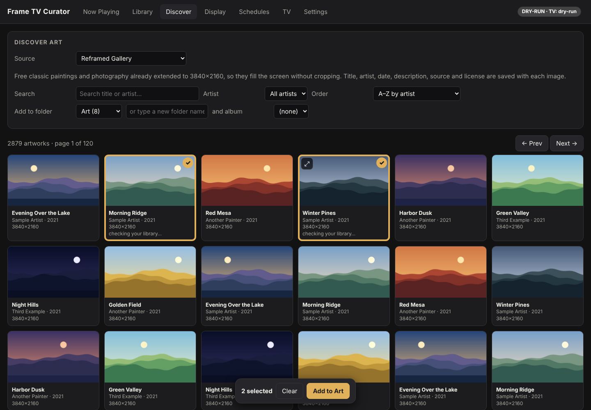

# Discover (find free art)

Discover finds public-domain and openly licensed art from museums and archives and adds it to your library, with the title, artist, date, credit, license and source link filled in.

*(Sample pictures shown.)*

## Sources

Eight sources are built in. Pick one from the **Source** menu at the top of the Discover tab.

| Source | What you get | Key needed? | License |
|---|---|---|---|
| **Reframed Gallery** | Classic paintings and photography already extended to 3840x2160, so they fill the screen. | No | Free per the site |
| **Art Institute of Chicago** | Public-domain paintings, prints, drawings, watercolors, photographs and posters at 3000 px (the largest the museum publishes). | No | CC0 (descriptions CC BY 4.0) |
| **The Metropolitan Museum of Art** | Public-domain works, Highlights or by department, often with very large originals. | No | CC0 |
| **Cleveland Museum of Art** | Open-access paintings, prints, drawings, photographs, textiles and sculpture at up to about 3400 px. | No | CC0 |
| **NASA Image Library** | Space and Earth images by topic or search (under 1600 px wide are skipped). | No | Generally public domain |
| **Wikimedia Commons** | Ukiyo-e, holiday postcards, vintage and Art Nouveau posters, Google Art Project paintings, pop art, digital art, or any search; up to 3840 px. | No | Public domain, CC0, CC BY, CC BY-SA |
| **Smithsonian** | Art, design, portraits and more from the Smithsonian museums (at least 1600 px wide). | **Yes** (free) | CC0 |
| **Getty Museum** | Paintings, drawings, prints and photographs from the Getty's Open Content (about 160,000 CC0 images). | No | CC0 |

CC BY and CC BY-SA pictures (Commons) need credit; the artist and license are saved with each picture and can appear on the placard and in the Info tab.

Some sources can show fewer than 24 pictures on a page because only suitable files are listed (public domain, with an image, large enough).

### Search all sources

The first item in the **Source** list, **Search all sources**, looks for your words in every source at once and shows the first six results from each, mixed together with the source's name on each card. Use it to see where a subject exists (for example "lighthouse" or "Hokusai"), then pick that source to browse it fully with its types and paging. Notes:

- You need to type something in Search; with nothing typed it shows a hint.
- Only the first page from each source is shown, and every source uses its own "all types" setting.
- Sources that cannot be reached are named under the results; the others still show.
- The Shape filter and the Add button work as usual. Pictures are added with the same checks and credits as from the single source.

## Add pictures, step by step

1. Open the **Discover** tab.
2. Choose a **Source**. Depending on the source, choose a **Type** (or museum, topic or category), **Artist**, **Order** and **Shape**.
3. Optional: type a title or artist in **Search** and press Enter.
4. Click a picture to select it (a check mark appears). Click the small expand button on a card for a **full-screen preview** with size, license, description and any duplicate warning; use the arrow keys to browse.
5. Choose where to put the pictures: **Add to folder** (pick an existing folder or type a new name), and optionally **and album** to also put them in an album.
6. Click **Add to ...** in the bar at the bottom. A progress dialog shows each download and closes itself with a summary when it is done.
7. Switch to the **Library** tab. The new pictures are in the folder you chose.

**Duplicates:** if a picture looks like one you already have (same image, or same title and artist), a comparison shows both with their sizes, file sizes and sources. Choose **skip** (the default), **keep both** or **replace** (the old file goes to `_trash`).

**Remembering your place:** Discover restores your last source, type, search, artist, order, page, folder and album when you return.

Please keep the polite request rate; the add-on already limits how fast it asks each museum.

## Source guides

### Reframed Gallery
1. Source: **Reframed Gallery**.
2. Order by **A-Z by artist**, **Recently added** or **Shuffle**, and optionally pick an **Artist**.
3. Select and add. Pictures arrive at 3840x2160. A note on the card says when a picture was extended with AI.

### Art Institute of Chicago
1. Source: **Art Institute of Chicago**.
2. **Type**: Painting, Print, Drawing, Watercolor, Photograph, Poster or All types.
3. Select and add. Your browser downloads the image from the museum and uploads it to the add-on; the dialog tells you if it had to fall back to a smaller size.

### The Metropolitan Museum of Art
1. Source: **The Metropolitan Museum of Art**.
2. **Type**: **Highlights** or one of the museum's departments; or search by keyword.
3. Select and add. Original files are often several thousand pixels wide, so adds can take a little longer.

### Cleveland Museum of Art
1. Source: **Cleveland Museum of Art**.
2. **Type**: pick a kind of object, or **All types**.
3. Select and add. The museum's description and credit line are saved.

### NASA Image Library
1. Source: **NASA Image Library**.
2. Pick a **topic** or type a search.
3. Select and add. The credit line names the NASA center or photographer.

### Shape filter
**Shape** hides pictures that are not the shape you want, which is handy for finding art that fills the TV without a mat.

| Shape | Width compared with height | What it means on the TV |
|---|---|---|
| Fits the screen | 1.65 to 1.9 (16:9 is 1.78) | Fills the screen, no mat needed |
| Landscape | 1.15 to 1.65 | Mat or bars at the left and right |
| Wide / panoramic | wider than 1.9 | Mat or bars at the top and bottom |
| Square-ish | 0.85 to 1.15 | Mat at the sides |
| Portrait | narrower than 0.85 | Wide mat at the sides |

1. Choose a shape in **Shape**. The grid hides the others on the current page and a line says how many were hidden.
2. Use **Next** to look at more pages; the filter stays on.
3. Pictures whose size the source does not publish (The Met and Getty) are always shown, because there is no way to tell; the line says how many.
4. Choose **Any shape** to turn it off. The choice is remembered.

The filter works on each page of results, so a page can come up short when most pictures are another shape.

### Wikimedia Commons
1. Source: **Wikimedia Commons**.
2. **Type**: when you switch to Commons it opens on the postcard set for the season (Halloween postcards in October, Christmas postcards from 20 November to 6 January, Easter postcards from three weeks before Easter to a week after) and otherwise on the first preset; change it any time. Presets: (ukiyo-e prints, Christmas / Easter / Halloween postcards, vintage travel posters, Art Nouveau posters, Google Art Project paintings, pop art, digital art) or **Search all**.
3. Optional: add a keyword.
4. Preview before adding: ukiyo-e results can include shunga prints.
5. Select and add. Only free licenses are shown, and the artist and license are saved.

### Smithsonian
1. Get a free key: go to https://api.data.gov/signup/ and sign up.
2. In Home Assistant open **Settings > Add-ons > Frame TV Curator > Configuration**, paste the key into **Smithsonian API key**, click **Save**.
3. **Restart** the add-on.
4. In Discover choose the source **Smithsonian**.
5. Pick a **Type** (a museum: American Art, Portrait Gallery, Cooper Hewitt, Freer | Sackler, Hirshhorn, African American History & Culture, American Indian, Air and Space) or **All museums**, and optionally search.
6. Select and add. Only CC0 pictures at least 1600 px wide are listed. Some Portrait Gallery records have no working image at the Smithsonian; those cards are hidden automatically.

Without a key the source explains what to do.

### Getty Museum
1. Source: **Getty Museum**.
2. **Type**: Paintings, Drawings, Prints, Photographs or All types; or search by title or artist.
3. Select and add. Images come at up to 3840 px (a smaller size when the original is smaller). The accession number goes into the credit line. Many Getty records have no date.

See the [Settings reference](Settings-Reference#discover) for what Discover remembers.
