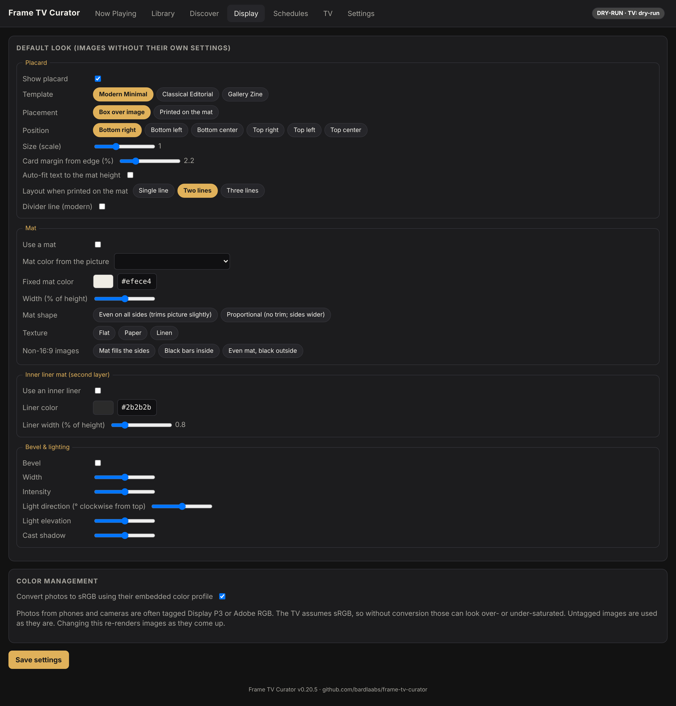
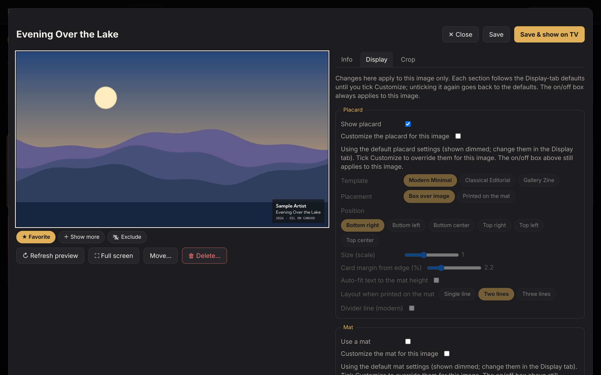

# Display defaults

> Defaults and per-image overrides are non-destructive: they are applied only when a picture is rendered for the TV, and per-image choices are stored in the sidecar ([Sidecar files](Sidecar-Files)). The image file itself is never changed.

The **Display** tab holds the **default look**: how every picture is rendered unless that picture has its own settings. This page lists each default, what it does and how to change it.

## The factory defaults

| Area | Setting | Default |
|---|---|---|
| Placard | Show placard | On |
| Placard | Template | Modern Minimal |
| Placard | Placement | Box over image (overlay) |
| Placard | Position | Bottom right |
| Placard | Size (scale) | 1.0 |
| Placard | Card margin from edge | 2.2 % |
| Placard | Auto-fit text to the mat height | Off |
| Placard | Layout when printed on the mat | Two lines |
| Mat | Use a mat | **Off** |
| Mat | Mat color | `#efece4` (warm off-white) |
| Mat | Mat color from the picture | Off (use the fixed color) |
| Mat | Width | 6 % of the picture height |
| Mat | Shape | Even on all sides |
| Mat | Texture | Flat |
| Mat | Non-16:9 pictures | Mat fills the sides |
| Inner liner | Use an inner liner | Off |
| Inner liner | Color / width | `#2b2b2b` / 0.8 % |
| Bevel and lighting | Bevel | On (only visible when a mat is used) |
| Bevel and lighting | Width / intensity | 0.4 % / 60 |
| Bevel and lighting | Light direction / elevation | 0° (from the top) / 50 |
| Bevel and lighting | Cast shadow | 35 |
| Overscan | Top / right / bottom / left | 0 % each |
| Overscan | How to compensate | Keep the picture full-screen; keep the card inside the visible area |
| Color | Convert to sRGB | On |

So out of the box a picture fills the screen with a small dark info card in the lower right, and no mat.

## Change the defaults, step by step

1. Open the **Display** tab.
2. Change any setting. Selection buttons light up when chosen; sliders show their value.
3. Scroll to the bottom and click **Save settings**.
4. The next picture that comes up uses the new look. Pictures already cached are re-rendered automatically when their look changed. Use **Show on TV** from the Library to see it immediately.

To go back to the factory look, set the values in the table above and save.

## Per-image overrides

Every section also exists inside the image editor (**Library > open a picture > Display** tab). Each section has a **Customize** checkbox:

1. Open the picture and choose the **Display** tab.
2. Under the section you want (Placard, Mat, Inner liner, or Bevel and lighting), tick **Customize ... for this image**. The dimmed default values become editable.
3. Change what you like and click **Save** (or **Save & show on TV**).
4. To return that picture to the defaults, untick **Customize** and save.

The on/off box in each section (for example **Show placard**) always applies to that picture, even when Customize is off.

## Where the defaults come from

Settings are layered, and the most specific one wins:

1. Built-in defaults (the table above).
2. The Display tab (your global look).
3. A picture's own **Customize** overrides (stored in its sidecar file).

## Suggested starting looks

| If you want | Try |
|---|---|
| Plain and clean | The defaults (no mat, Modern Minimal card, lower right) |
| A museum feel | Mat on, **Warm gallery white** from the picture, Classical Editorial placard printed on the mat, **Auto-fit text** on |
| Warm and traditional | Mat on, linen texture, an inner liner in a deep red or dark gray |
| Photos | Mat off, placard hidden or Modern Minimal, sRGB conversion on |

See [Display and look](Display-and-Look) for pictures of every option, and the [Settings reference](Settings-Reference) for every value.
