# Display and look

Pictures are rendered at 3840 x 2160 before they go to the TV. This page shows what each look option does. The factory values are in [Display defaults](Display-Defaults) and every setting is in the [Settings reference](Settings-Reference).

All samples below are made from one generated sample picture, so the only change between them is the setting being shown.

> **Nothing here changes your picture files.** The mat, inner liner (second mat), bevel, placard, overscan correction, crop, rotate and straighten are all applied while the add-on renders the picture for the TV. Your original file is never touched, and the settings live in the small sidecar file beside it ([Sidecar files](Sidecar-Files)). Turn any option off, or delete the sidecar, and you are back to the original.

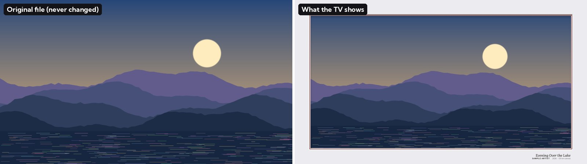

## Placards

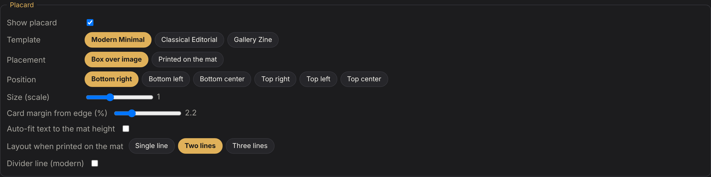

A placard is the small label with the artist, title, date and medium.

### Turn the placard on or off
1. Open **Display** (or the image editor's **Display** tab).
2. Tick or untick **Show placard**.
3. Click **Save settings** (or **Save** in the editor).

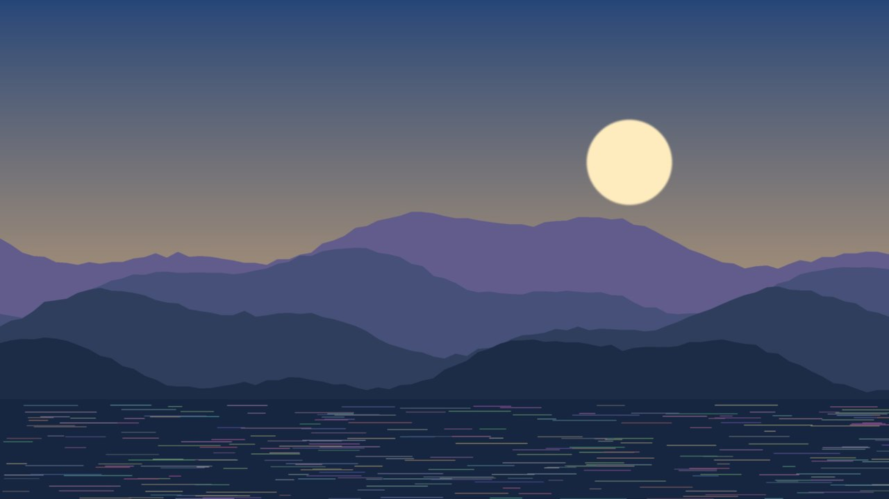

### Choose a template
1. In the **Placard** card, click one of **Modern Minimal**, **Classical Editorial** or **Gallery Zine** next to **Template**.
2. Save.

| Modern Minimal (default) | Classical Editorial | Gallery Zine |
|---|---|---|
|  | 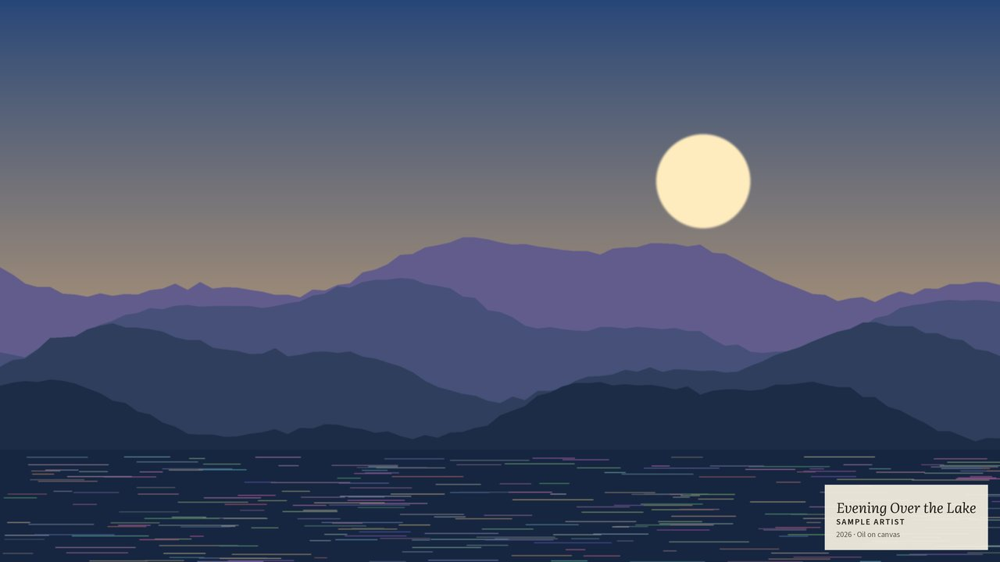 | 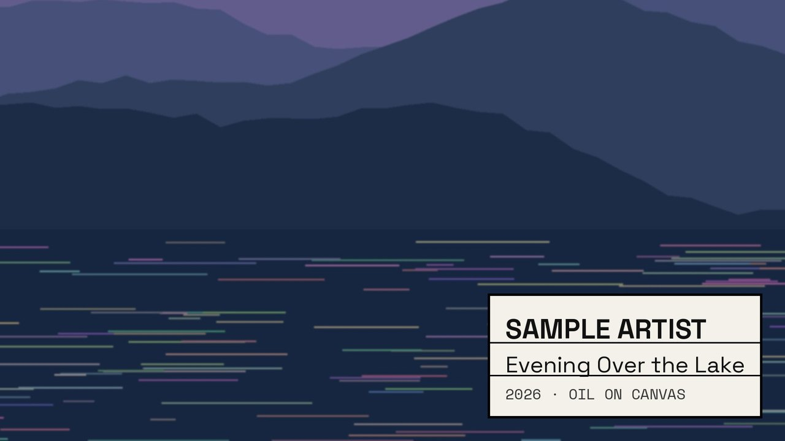 |

### Position and size
1. Next to **Position** choose one of six places (bottom right is the default).
2. Move **Size (scale)** to make the text smaller (below 1) or larger (above 1).
3. Move **Card margin from edge (%)** to change the gap between the card and the screen edge.

| Bottom left | Top right | Larger (1.6) |
|---|---|---|
|  |  | 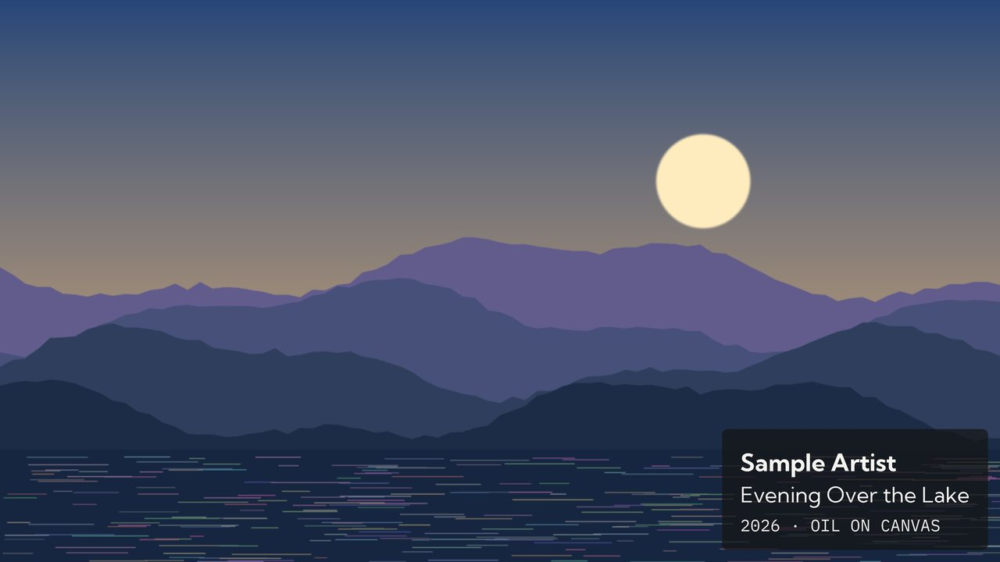 |

### Print the placard on the mat
This needs a mat (see below).
1. Turn on **Use a mat**.
2. Next to **Placement** choose **Printed on the mat**.
3. Choose **Single line**, **Two lines** or **Three lines** for **Layout when printed on the mat**.
4. Optional: tick **Auto-fit text to the mat height** so the text fills the mat strip as large as it can.
5. Save.

Layout samples (the mat strip, close up):

| Single line | Two lines | Three lines |
|---|---|---|
| 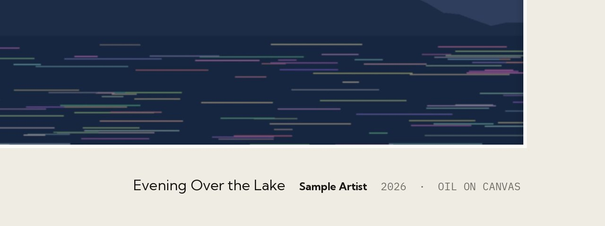 |  |  |

| Printed on the mat | Auto-fit text |
|---|---|
|  |  |

## Framing: whole artwork or fill the screen

**Framing mode** (Display tab, first card) decides what happens to a picture that is not 16:9:

- **Whole artwork** (default) keeps all of the picture. A mat or black bars fill the leftover space, as set under Mats.
- **Fill the screen** crops the picture to 16:9 so it covers the whole TV, with no mat. The mat settings are ignored while it is on.

The crop is centered, and it is only made in the rendered copy sent to the TV; the file is never changed. To choose which part is kept, use the editor's Crop tab (a crop you set there is applied first). In an image's editor, tick **Customize the framing for this image** to give just that picture its own mode, for example Fill the screen for a landscape photo and Whole artwork for everything else.

## Mats

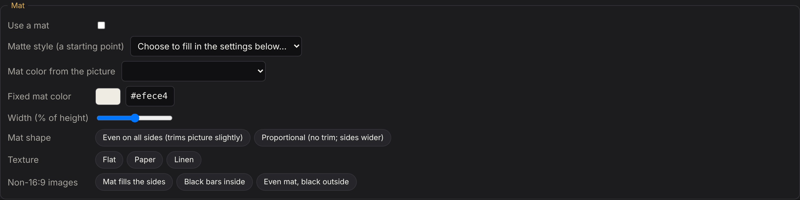

A mat is the border between the picture and the edge of the screen. It is off by default.

### Matte styles (starting points)

The **Matte style** menu at the top of the Mat section fills in the settings below it in one step, so you can start from a look and then adjust:

| Style | What it sets |
|---|---|
| Classic gallery | 6 % flat mat, even on all sides, no liner, soft bevel and shadow (the default look) |
| Modern (thin, flat) | 3.5 % flat mat, proportional shape (no trim), no liner, barely-there bevel and shadow |
| Shadow box | 9 % paper mat, dark inner liner, deep bevel and a strong cast shadow |
| Panoramic (wide pictures) | 5 % mat, proportional, mat fills the sides, a thin liner |

Choosing a style changes only width, shape, texture, liner, bevel and shadow (and mat fill for Panoramic); your mat color and on/off setting stay as they are. In a picture's editor it works with **Customize the mat**.

### Turn on a mat
1. In the **Mat** card tick **Use a mat**.
2. Pick a color: either type or choose a **Fixed mat color**, or use **Mat color from the picture** (see below).
3. Set **Width (% of height)**.
4. Save.

### Mat shape: even or proportional
- **Even on all sides** gives the same border all around. A picture that is not 16:9 is trimmed slightly to fit.
- **Proportional** keeps the whole picture and makes the sides wider if needed, with no trimming.

| Even | Proportional |
|---|---|
|  |  |

### Mat colors and textures
**Texture** can be **Flat**, **Paper** (a faint grain) or **Linen** (a woven pattern).

| Dark mat | Paper | Linen |
|---|---|---|
|  |  | 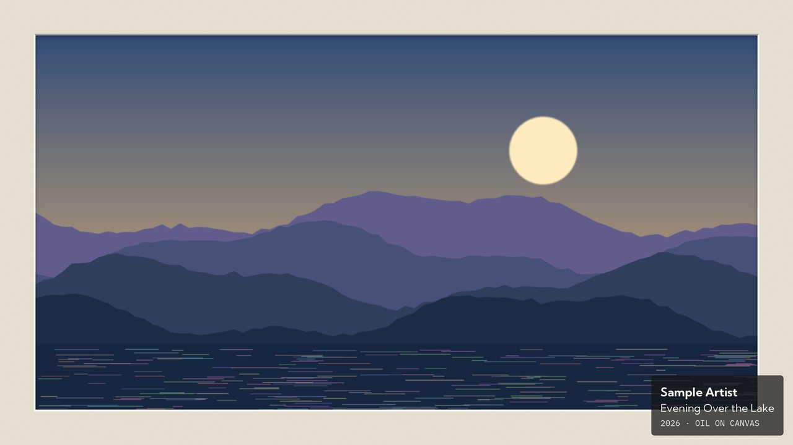 |

### Mat color from the picture
Set **Mat color from the picture** to let the add-on choose a color from the artwork's own palette, so every picture gets a matching mat.

| Warm gallery white | Deep neutral | Accent tint |
|---|---|---|
|  | 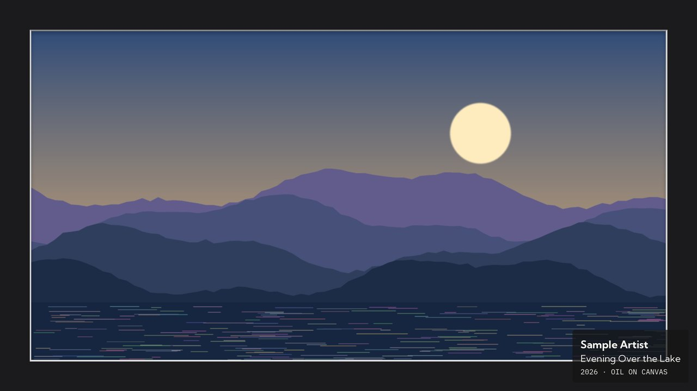 |  |

| Complement | Dominant muted |
|---|---|
|  | 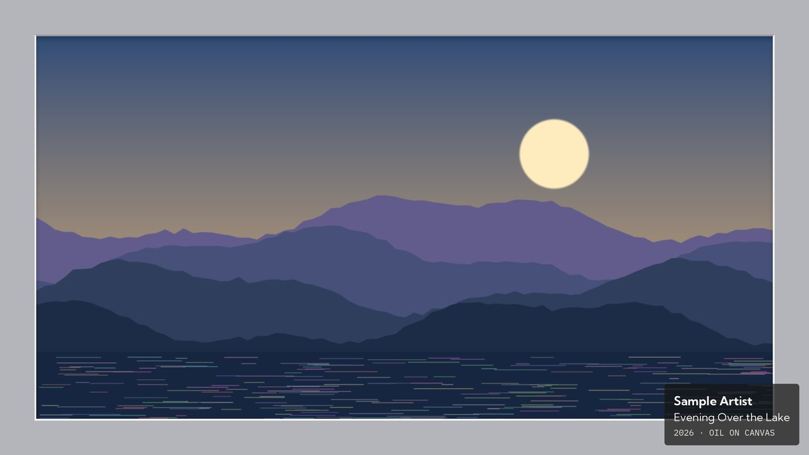 |

**Best contrast with the picture** chooses whichever of these stands out most from the picture's edge. Leave the menu blank to use the fixed color.

### Pictures that are not 16:9
**Non-16:9 images** decides what fills the extra space: **Mat fills the sides** (default), **Black bars inside** the mat, or **Even mat, black outside**.

## Inner liner (second mat layer)

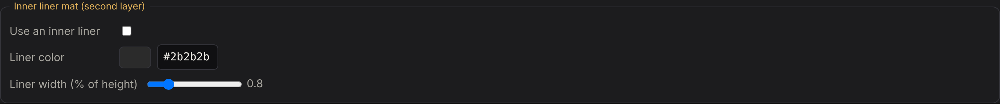

A thin second mat right around the picture, as in a framed print.

1. Turn on **Use a mat**, then in **Inner liner mat** tick **Use an inner liner**.
2. Choose **Liner color** and **Liner width (% of height)** (default 0.8).
3. Save.

| Red liner | Dark liner |
|---|---|
|  |  |

## Bevel and lighting

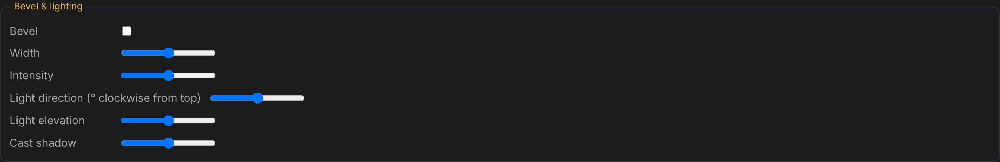

The bevel is the angled cut edge of the mat opening, lit from a direction you choose, with an optional shadow on the mat.

1. Turn on **Use a mat**.
2. In **Bevel & lighting** tick **Bevel**.
3. Set **Width**, **Intensity**, **Light direction** (degrees clockwise from the top), **Light elevation** and **Cast shadow**.
4. Save.

| No bevel | Strong bevel and shadow |
|---|---|
|  |  |

## Overscan, the calibration grid and the color bars

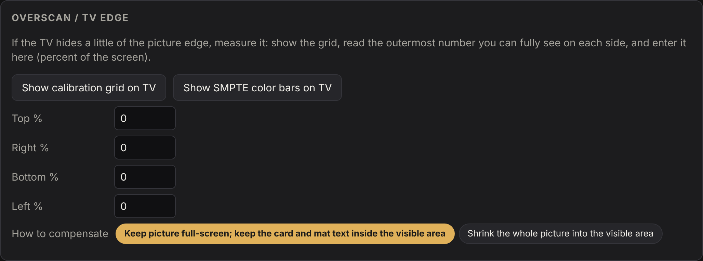

**What overscan is.** Some TVs scale the picture slightly so that a thin strip around the edge falls off-screen. For art it matters when a placard or the edge of a mat sits right at the border and gets clipped. The add-on can compensate, but it needs to know how much your TV hides on each side.

**What the add-on can do about it** (the **How to compensate** setting, `overscan.mode`):
- **Keep picture full-screen; keep the card and mat text inside the visible area** (`placard`, the default): the picture is unchanged, only the placard text is moved in from the hidden edge.
- **Shrink the whole picture into the visible area** (`inset`): the whole rendered image, mat included, is scaled down and centered on black so that none of it is hidden.

| No correction | Placard mode, 4 % | Inset mode, 4 % |
|---|---|---|
|  | 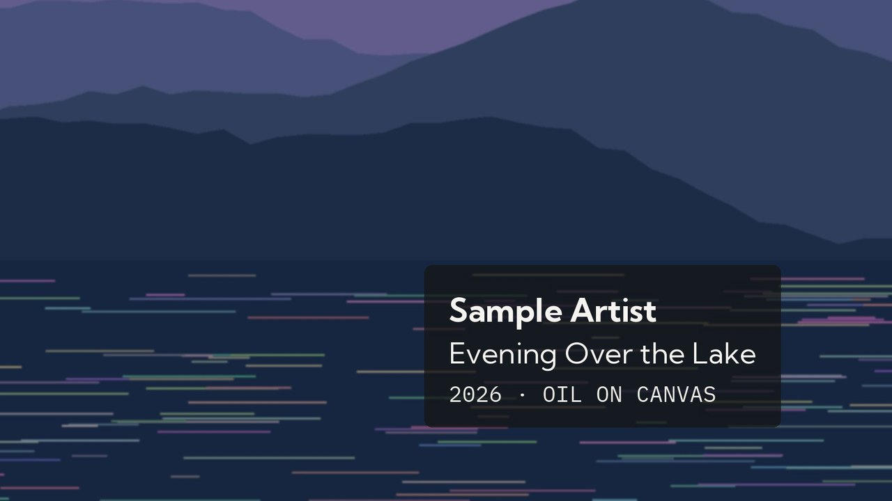 |  |

The first two are close-ups of the lower-right corner: in placard mode the card moves in from the edge. The third is the whole picture.

### Measure your TV, step by step

1. Put the TV in **Art Mode** (the grid is shown as a picture).
2. Open the **TV** tab, **Overscan / TV edge** card.
3. Click **Show calibration grid on TV**. After a few seconds the TV shows this pattern:

   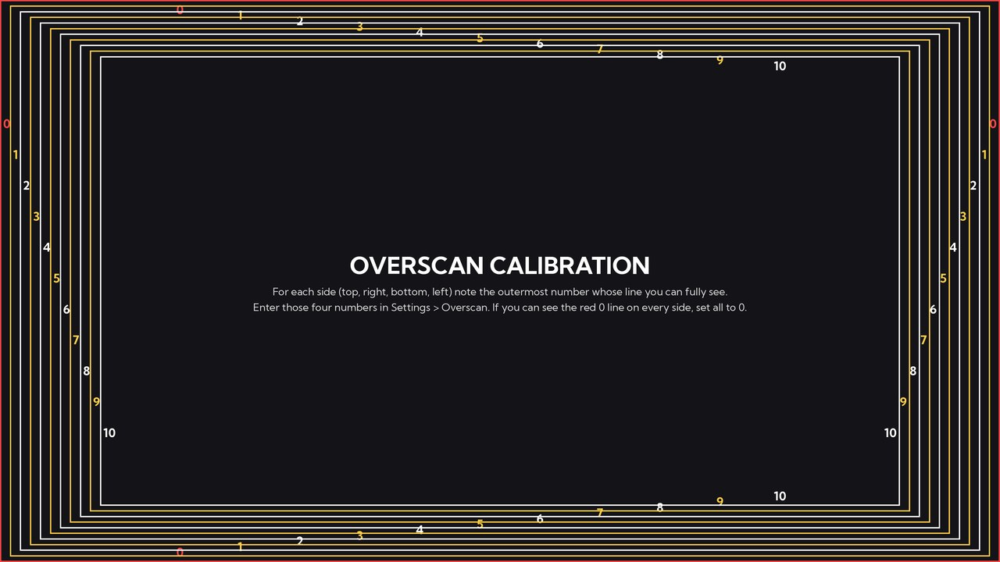

   The grid is a set of nested outlines, one every 1 % of the screen, numbered 0 (red, the very edge of the picture) to 10. The number is the percentage of the screen that lies between that outline and the edge.
4. Stand at your normal viewing distance. For each of the four sides separately, find the **outermost outline whose line you can see completely**, and note its number. If you can see the red 0 line along a side, that side is 0.
5. Enter the four numbers as **Top %**, **Right %**, **Bottom %** and **Left %**.
6. Choose **How to compensate**, click **Save settings**, then press **Resend art** on Now Playing to see the result.

**Worked example.** Suppose the TV hides a little of the picture. You look at the grid and the screen shows this (the outlines 0, 1 and 2 are cut off, and 3 is the first one you can see in full on all four sides):

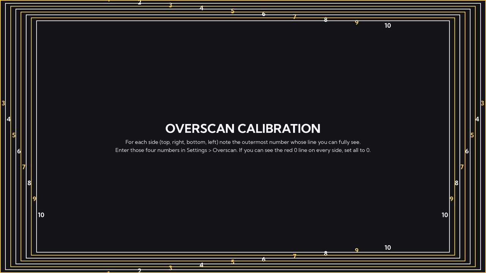

Enter 3 for all four sides. The numbers do not have to match: it is common for the left and right to differ, or for the top and bottom to differ, so read every side on its own.

Tips for reading the numbers:
- The numbers are written along each outline, so you can read a side without counting lines. The top and bottom numbers are spread along the edge, the left and right numbers run down it.
- If you are unsure between two numbers, choose the larger one. A little extra margin costs nothing.
- Measure with the TV set the way you normally use it; if you change its picture size or zoom setting later, measure again.
- You only need to measure once per TV. Per-image overrides are possible too ([Per-image looks](#per-image-looks)), but the TV edge does not change from picture to picture.

### Turn overscan correction on and off
- **On:** enter any non-zero number and save. Placard mode only affects pictures that show a placard; inset mode affects every picture.
- **Off:** set all four numbers back to 0 and save. (Factory default is 0 with placard mode, which does nothing.)
- The correction is part of the render, so it is applied to the next picture shown. Press **Resend art** to apply it to the current one.

### The SMPTE color bars

The same card has **Show SMPTE color bars on TV**. It sends a standard test pattern (75 % color bars with a reverse-blue strip and a PLUGE row) that you can use to check the TV's color, black level and contrast in Art Mode:

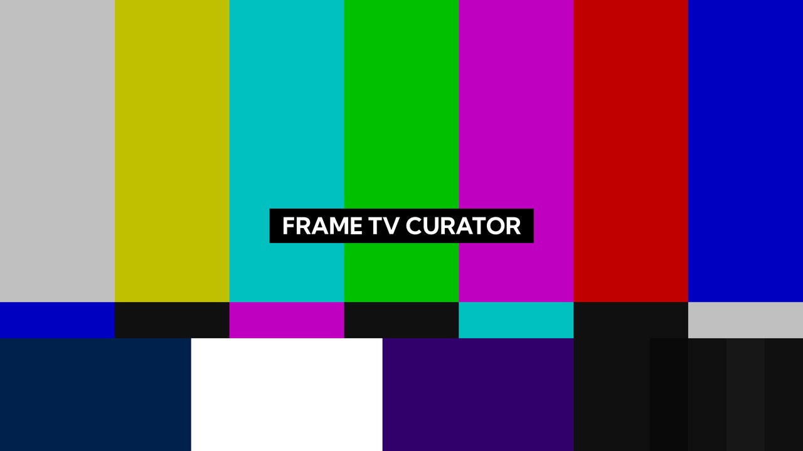

- The seven bars should be clearly separate: gray, yellow, cyan, green, magenta, red and blue.
- In the dark strip at the bottom right, the three narrow bars are slightly darker and lighter than black. If you cannot tell the darkest one from pure black, the screen is too dark; if the black area looks gray, it is too bright. This is the check to use when setting [art brightness](Optional-Ambient).
- Colors that look tinted point at the color temperature setting.

### Turn the patterns on and off
- **On:** click **Show calibration grid on TV** or **Show SMPTE color bars on TV** on the TV tab. The Now Playing tab then shows a banner saying a test pattern is on the TV.
- **Off:** press **Next** or **Resend art** on the Now Playing tab, or just wait: rotation resumes by itself at the next change time (the patterns only hold rotation for one interval).
- The patterns are generated each time; they are never saved in your library and never get a sidecar.

## sRGB conversion

Phone and camera photos are often tagged Display P3 or Adobe RGB, but the TV assumes sRGB. With **Convert photos to sRGB using their embedded color profile** on (the default), those photos keep their intended colors. Untagged images are left as they are.

## Per-image looks

Any picture can have its own look: open it in the Library, choose **Display**, tick **Customize** in the section, and save. See [Display defaults](Display-Defaults#per-image-overrides).
