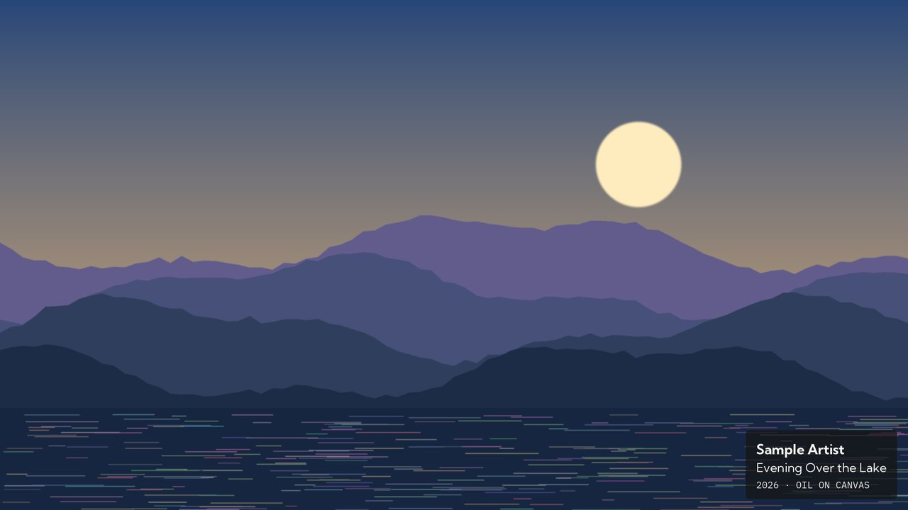
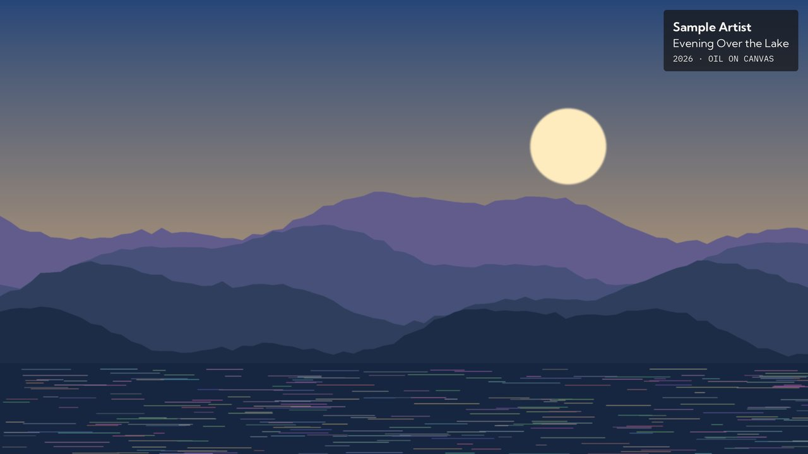
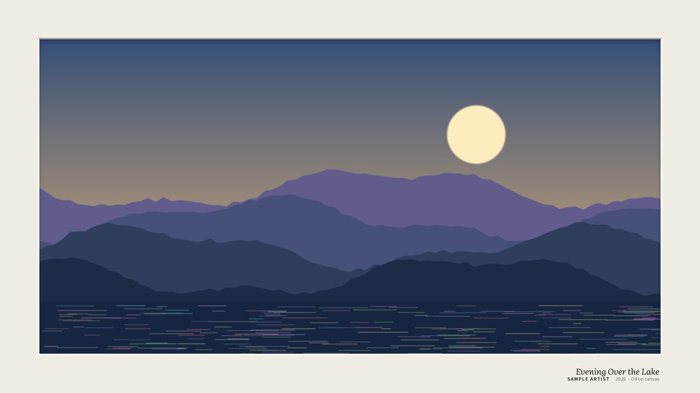
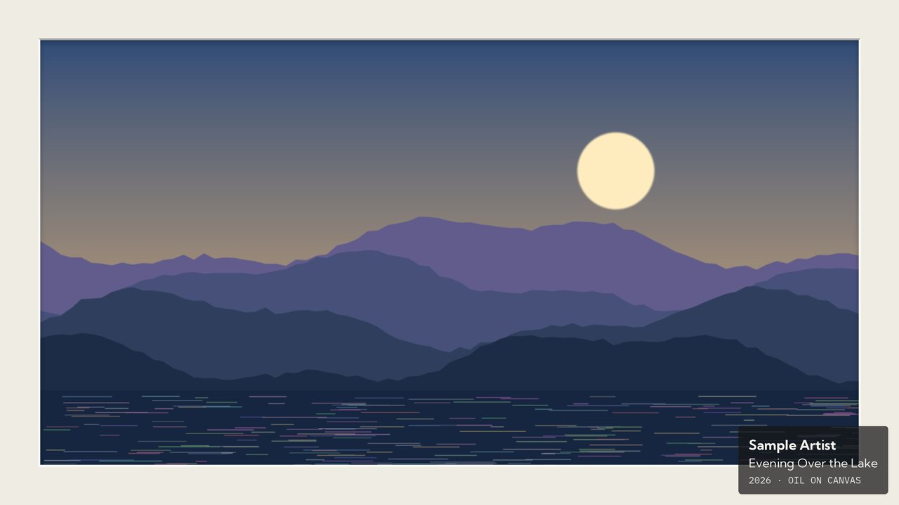
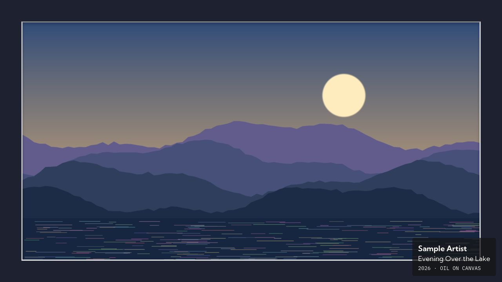
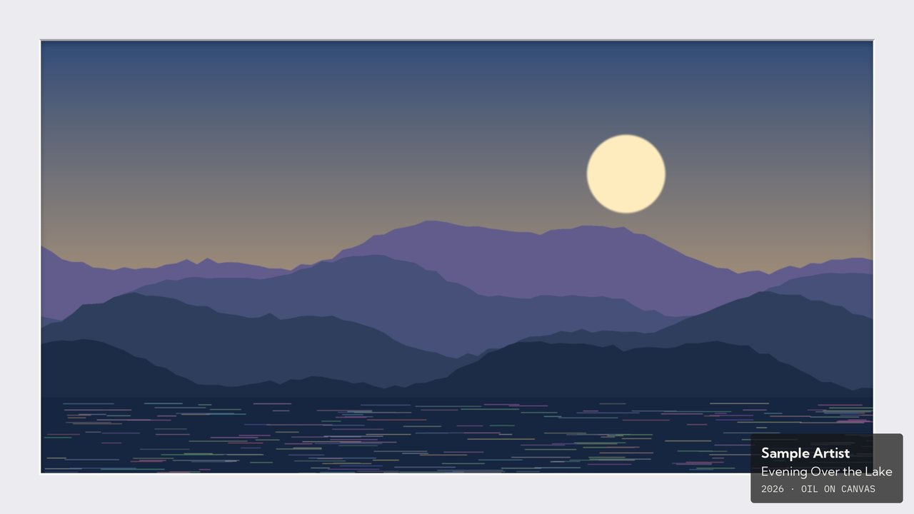
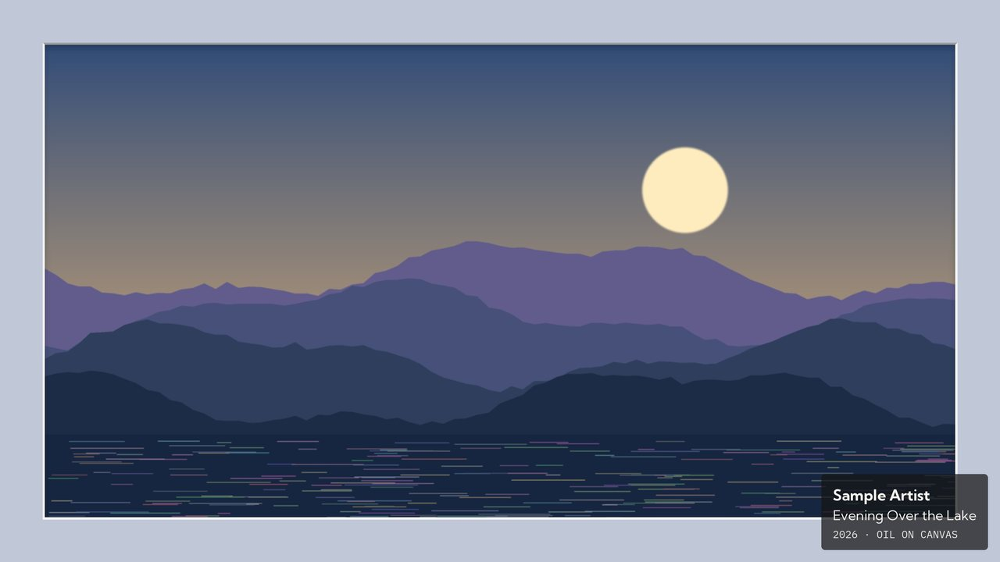
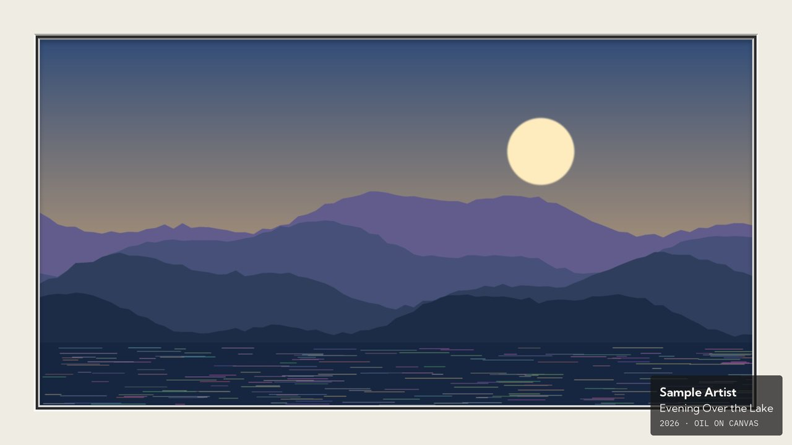
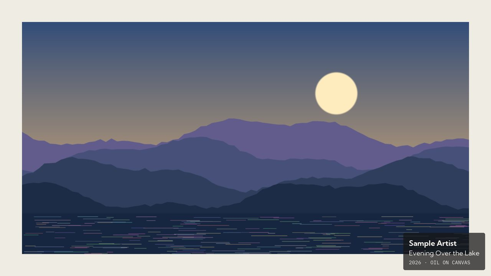
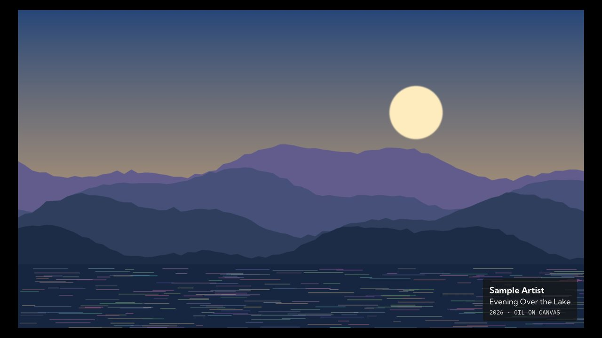

# Display and look

Pictures are rendered at 3840 x 2160 before they go to the TV. This page shows what each look option does. The factory values are in [Display defaults](Display-Defaults) and every setting is in the [Settings reference](Settings-Reference).

All samples below are made from one generated sample picture, so the only change between them is the setting being shown.

## Placards

A placard is the small label with the artist, title, date and medium.

### Turn the placard on or off
1. Open **Display** (or the image editor's **Display** tab).
2. Tick or untick **Show placard**.
3. Click **Save settings** (or **Save** in the editor).

### Choose a template
1. In the **Placard** card, click one of **Modern Minimal**, **Classical Editorial** or **Gallery Zine** next to **Template**.
2. Save.

| Modern Minimal (default) | Classical Editorial | Gallery Zine |
|---|---|---|
|  |  |  |

### Position and size
1. Next to **Position** choose one of six places (bottom right is the default).
2. Move **Size (scale)** to make the text smaller (below 1) or larger (above 1).
3. Move **Card margin from edge (%)** to change the gap between the card and the screen edge.

| Bottom left | Top right | Larger (1.6) |
|---|---|---|
|  |  |  |

### Print the placard on the mat
This needs a mat (see below).
1. Turn on **Use a mat**.
2. Next to **Placement** choose **Printed on the mat**.
3. Choose **Single line**, **Two lines** or **Three lines** for **Layout when printed on the mat**.
4. Optional: tick **Auto-fit text to the mat height** so the text fills the mat strip as large as it can.
5. Save.

| Printed on the mat | Auto-fit text |
|---|---|
|  |  |

## Mats

A mat is the border between the picture and the edge of the screen. It is off by default.

### Turn on a mat
1. In the **Mat** card tick **Use a mat**.
2. Pick a color: either type or choose a **Fixed mat color**, or use **Mat color from the picture** (see below).
3. Set **Width (% of height)**.
4. Save.

### Mat shape: even or proportional
- **Even on all sides** gives the same border all around. A picture that is not 16:9 is trimmed slightly to fit.
- **Proportional** keeps the whole picture and makes the sides wider if needed, with no trimming.

| Even | Proportional |
|---|---|
|  |  |

### Mat colors and textures
**Texture** can be **Flat**, **Paper** (a faint grain) or **Linen** (a woven pattern).

| Dark mat | Paper | Linen |
|---|---|---|
|  |  |  |

### Mat color from the picture
Set **Mat color from the picture** to let the add-on choose a color from the artwork's own palette, so every picture gets a matching mat.

| Warm gallery white | Deep neutral | Accent tint |
|---|---|---|
|  |  |  |

| Complement | Dominant muted |
|---|---|
|  |  |

**Best contrast with the picture** chooses whichever of these stands out most from the picture's edge. Leave the menu blank to use the fixed color.

### Pictures that are not 16:9
**Non-16:9 images** decides what fills the extra space: **Mat fills the sides** (default), **Black bars inside** the mat, or **Even mat, black outside**.

## Inner liner (second mat layer)

A thin second mat right around the picture, as in a framed print.

1. Turn on **Use a mat**, then in **Inner liner mat** tick **Use an inner liner**.
2. Choose **Liner color** and **Liner width (% of height)** (default 0.8).
3. Save.

| Red liner | Dark liner |
|---|---|
|  |  |

## Bevel and lighting

The bevel is the angled cut edge of the mat opening, lit from a direction you choose, with an optional shadow on the mat.

1. Turn on **Use a mat**.
2. In **Bevel & lighting** tick **Bevel**.
3. Set **Width**, **Intensity**, **Light direction** (degrees clockwise from the top), **Light elevation** and **Cast shadow**.
4. Save.

| No bevel | Strong bevel and shadow |
|---|---|
|  |  |

## Overscan

Some TVs hide a thin strip around the edge. To measure it:

1. Open the **TV** tab, **Overscan / TV edge** card.
2. Click **Show calibration grid on TV**.
3. On each side, read the outermost number you can fully see and enter it as **Top %**, **Right %**, **Bottom %** and **Left %**.
4. Choose how to compensate: **Keep picture full-screen** (the card and mat text move inside the visible area) or **Shrink the whole picture into the visible area**.
5. Click **Save settings**.

## sRGB conversion

Phone and camera photos are often tagged Display P3 or Adobe RGB, but the TV assumes sRGB. With **Convert photos to sRGB using their embedded color profile** on (the default), those photos keep their intended colors. Untagged images are left as they are.

## Per-image looks

Any picture can have its own look: open it in the Library, choose **Display**, tick **Customize** in the section, and save. See [Display defaults](Display-Defaults#per-image-overrides).
