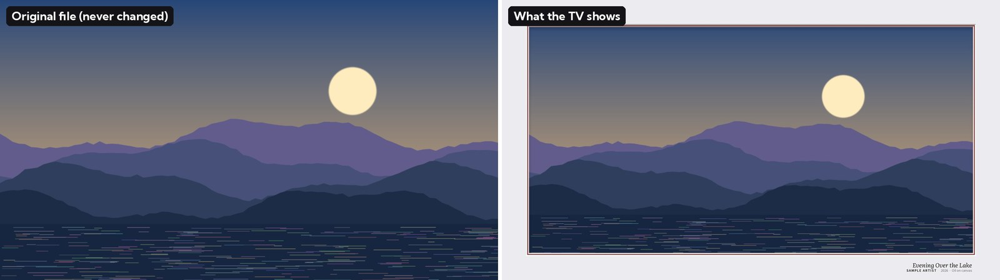
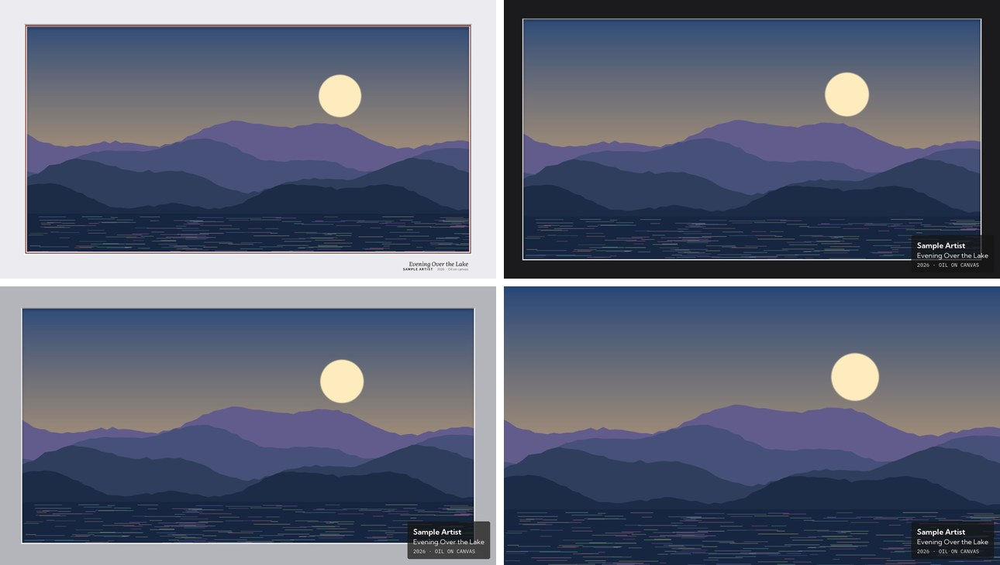
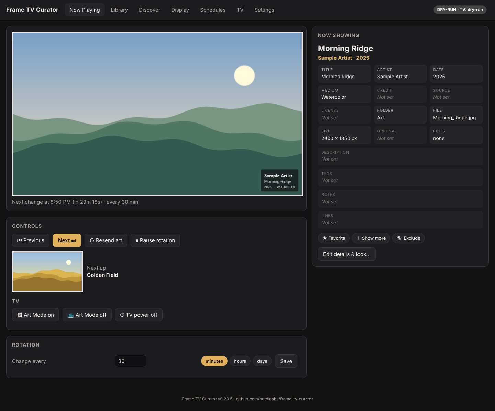
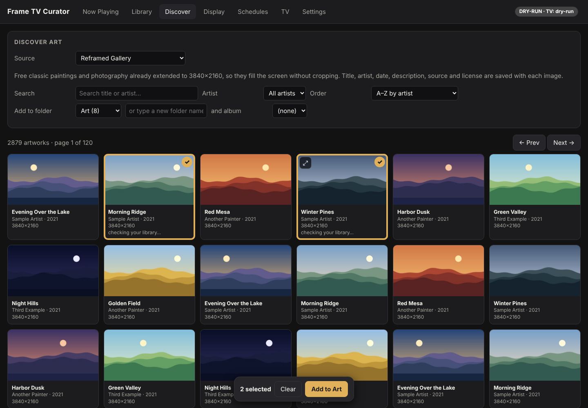
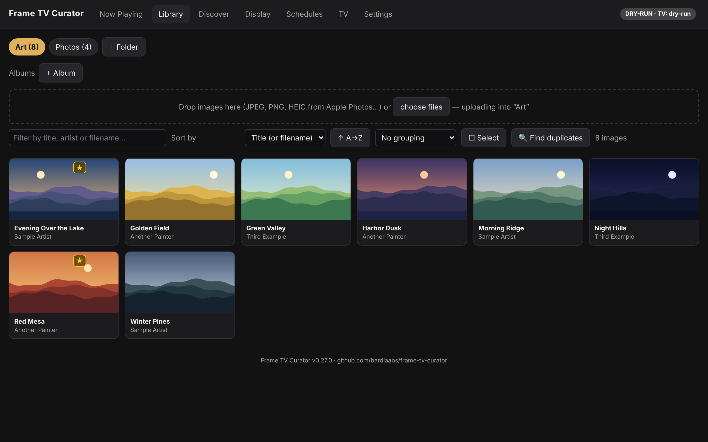

# Features

Everything Frame TV Curator can do, in one list. Follow the links for step-by-step instructions.

> **Non-destructive by design.** Mats, inner mats (liners), bevels, placards, overscan correction, crop, rotate and straighten never change your picture files. They are applied when a picture is rendered for the TV, and your choices live in a small sidecar file beside each image. Turn an option off and the original is exactly as it was. ([Sidecar files](Sidecar-Files))

## Highlights

**A gallery look, not just a slideshow.** Mats with an inner liner and a cut bevel, color picked from the picture, and a museum-style placard:

**Placards that fit the mat.** Print the artist, title, date and medium on the mat in one, two or three lines (the strip below is the bottom of the mat, close up):

**Browse and control it from one place.** Now Playing shows what is on the TV, what is next and what the TV is doing:

**Find free art without leaving the add-on.** Discover searches public-domain collections and fills in the artist, title, date and credit for you:

**A big, fast library.** Group, tag, flag and preview your pictures, with a full-screen preview and keyboard shortcuts:

## Picking and rotating pictures
- **Shuffle-bag rotation** shows every picture once before any repeats, so the TV never gets stuck on the same few. ([Rotation](Rotation-and-Schedules))
- **Favorites and Show more** make chosen pictures appear more often, while **Exclude** keeps a picture out of rotation entirely.
- **Folder, weighted mix or album sources** let rotation draw from one folder, from several folders by percentage, or from a hand-picked album.
- **Flexible interval** changes the picture every few minutes or hours, or once a day at a set time.
- **Quiet hours** freeze the picture during a window you choose, such as overnight.
- **Schedules and special occasions** replace the normal source by time of day, day of week or date range, such as a holiday image every December 24-25.
- **Next-up preview** shows which picture is coming next on the Now Playing tab.
- **Art Mode only pushes** mean the add-on never interrupts you while you are watching regular TV.
- **Bird Frame interleave** mixes bird pictures into the rotation every so many changes or minutes. ([Bird Frame](Optional-Extras))

## Library and organizing
- **Folders on your media share** map to simple subfolders, and files you drop in appear within a minute.
- **Non-destructive sidecars** keep titles, edits, flags and display settings in a small file beside each image, so originals never change. ([Sidecar files](Sidecar-Files))
- **Search, sort and group** the grid by title, artist, year, decade or medium, with sticky headings and jump chips.
- **Mood and tags** let you label pictures your own way (a mood such as *calm*, tags such as *winter*) and find them by search.
- **Several named crops** per picture let you keep, for example, the whole scene and a detail. Nothing changes in the original.
- **Albums** are named collections that can mix images from any folder.
- **Tags** are your own words for finding pictures, with filter chips, search and bulk add or remove.
- **Quick flag buttons** on every tile set Favorite, Show more or Exclude with one click.
- **Bulk actions** flag, tag, move, add to an album, set info or delete many pictures at once.
- **Move dialog** offers a dropdown of existing folders (with counts) or a new folder name.
- **Large preview (lightbox)** shows a picture big with keyboard shortcuts for flags, editing and showing it on the TV.
- **Duplicate finder** spots look-alike pictures by comparing their content, not just file names.
- **Low-resolution warning** flags pictures too small to look good on a 4K screen.
- **Daily sidecar backups** copy your titles, settings and edits to the share and keep the newest 14.
- **Format conversion** turns HEIC, WebP, TIFF and BMP files into JPEG automatically.
- **EXIF prefill and place names** fill in the date, camera and a readable location for photos with GPS data.

## Editing a picture
All editing is non-destructive: your edits are saved as instructions in the sidecar and applied at render time, so the original file is never rewritten.

- **Crop** lets you choose the part of a picture to show, in 16:9 or any shape.
- **Rotate left/right and straighten** turn a sideways picture 90 degrees or level a tilted one without touching the original (not to be confused with *rotation*, which changes the picture on the TV over time).
- **Info and Details** store title, artist, date, medium, credit, description, source link, license, tags and private notes.
- **Per-image Customize** lets any picture override the default placard, mat, inner liner or bevel while the rest follow the defaults.
- **Save & show on TV** renders the picture and sends it to the TV right away.

## Look: mats and placards
- **Mats** add a gallery-style border in any color, width, shape and texture. ([Display and look](Display-and-Look))
- **Auto mat color** picks a mat color from the picture itself, such as warm white, deep neutral, accent, complement or dominant.
- **Inner liner** adds a thin second mat layer around the picture.
- **Bevel and lighting** give the mat opening a realistic cut edge with adjustable light direction and cast shadow.
- **Placards** print the artist, title, date and medium on a small card in three styles (Modern Minimal, Classical Editorial, Gallery Zine).
- **Placard placement** puts the card over the picture in any of six positions or prints it on the mat itself.
- **Auto-fit text** makes mat placards as large as the mat allows.
- **Overscan correction** keeps the card and mat inside the part of the screen your TV actually shows.
- **sRGB color conversion** corrects wide-gamut phone and camera photos so colors look right on the TV.
- **Rendered image cache** reuses finished pictures until you change something.

## Discover (find free art)
- **Eight museum and archive sources** let you browse and add free pictures: Reframed Gallery, Art Institute of Chicago, The Met, Cleveland Museum of Art, NASA, Wikimedia Commons, the Smithsonian and the Getty. ([Discover](Discover))
- **Search, filters and ordering** work by keyword, artist, type or museum, depending on the source.
- **Full-screen preview** shows a work with its size, license and description before you add it.
- **Metadata saved automatically** fills in title, artist, date, credit, license and source link.
- **Duplicate check on add** warns when you already own a picture and lets you skip, keep both or replace.
- **Add to folder and album** puts new pictures where you want them in one step.
- **Remembers your place** by restoring the last source, search and page when you return.

## TV control
- **Connection and remote buttons** turn Art Mode on or off, power the TV off and step through pictures. ([TV tab](TV-Tab))
- **Wake-on-LAN** turns on a fully powered-off TV when you set its MAC address.
- **TV picture cache** keeps recent pictures and favorites on the TV so they come back in seconds without uploading again.
- **Art brightness** can be fixed, follow a lux sensor, follow another entity or follow the time of day. ([Ambient](Optional-Ambient))
- **Brightness steadiness** stops the TV from flickering between two neighboring brightness steps.
- **Art color temperature** can be fixed, follow the sun or follow a lamp or an Adaptive Lighting switch.
- **Companion light** turns a lamp on and off with the TV and can match its brightness and warmth.
- **Calibration grid and SMPTE color bars** can be sent to the TV to measure its hidden edge and to check its color and black level. ([Overscan and test patterns](Display-and-Look#overscan-the-calibration-grid-and-the-color-bars))

## Presence
- **Presence on/off** turns the TV off after everyone has left and back on to Art Mode when someone returns. ([Presence](Optional-Presence))
- **Any number of sensors** count as "someone is home" if any one reports presence.
- **Active hours and fallback hours** limit when it acts and keep working if sensors go unavailable.
- **Survives restarts** so updating the add-on while you are away does not stop the TV from waking later.
- **TV motion sensor controls** set the Frame's own motion sensitivity and timer from the same card.

## Other
- **E-paper card** sends the current picture's title and artist to a small e-paper display.
- **Health check** at `/api/health` reports whether the add-on is working, for monitoring from Home Assistant.
- **Version footer** shows the add-on version at the bottom of every page.
- **Logging level** choice (debug to errors) takes effect immediately without a restart.
- **Dry-run mode** renders everything without touching the TV, which is handy for testing.

## Now Playing status picture

When the TV is off, or on but not in Art Mode, Now Playing shows a "TV is off" or "TV is on" picture rather than the last art.
