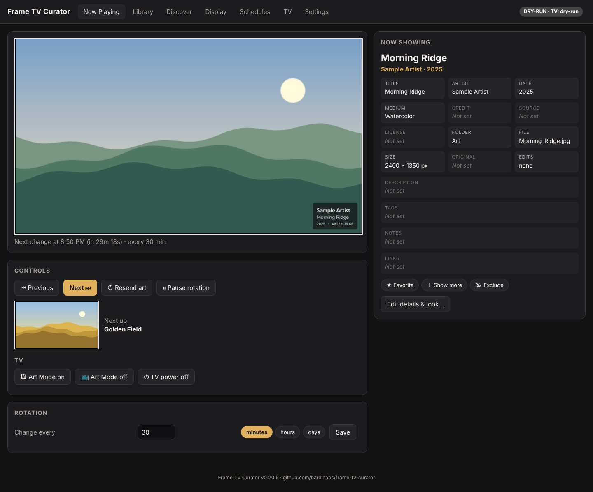

# Getting started

A two-minute tour of the app first:

## What you need
- A Samsung Frame TV on the same network/VLAN as Home Assistant (tested on a 2022 model).
- Home Assistant OS or Supervised (add-ons).
- A media share mapped as `/media` in Home Assistant.
- A `media_player` entity for the TV. The author uses the `TheFab21/ha-samsungtv-smart` integration in local-only mode.

## Minimal setup (about 5 minutes)
1. **Install.** Use the "Add to my Home Assistant" button in the README, or add `https://github.com/bardlaabs/frame-tv-curator` under Settings > Add-ons > Add-on Store > Repositories. Install and start **Frame TV Curator**.
2. **Give it the TV.** In the add-on **Configuration** tab set `tv_ip` to the TV's address (leave blank to take it from the media player entity). In the add-on panel open the **TV** tab and confirm the media player entity (default `media_player.frametv`).
3. **Put images in place.** Copy images into the `frame` folder on your media share, for example `frame/Art/` and `frame/Photos/`. New files appear within a minute.
4. **Pair.** Open **Frame Curator** from the sidebar. The first time the add-on connects, accept the pairing prompt on the TV.
5. **Pick a rotation.** In **Settings** choose how often the picture changes and which folder(s) to use.

That is all that is required. The TV must be in Art Mode for pushes to happen.

## Recommended, but optional
- **TV MAC address** (TV tab): lets the add-on wake a fully powered-off TV with Wake-on-LAN.
- **Display look** (Display tab): defaults are no mat, `modern_minimal` placard, lower-right overlay.

## Add-on options
| Option | Meaning |
|---|---|
| `log_level` | debug, info, warning or error |
| `tv_ip` | TV address; blank = taken from the media player entity |
| `dry_run` | Render but never touch the TV (good for testing) |

## Where things live
- Images and their `.json` sidecars: the media share (`/media/frame`). Originals are never modified.
- Settings, caches and state: the add-on's private `/data` folder (included in HA backups of the add-on).
