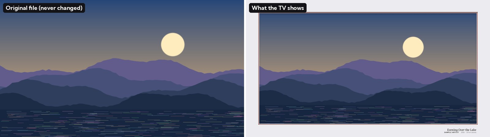

# Frame TV Curator manual

Frame TV Curator is a Home Assistant add-on that curates, renders and rotates art and photos on a Samsung **The Frame** TV.

**Your original pictures are never changed.** Mats, inner mats, bevels, placards, overscan correction, crop, rotate and straighten are all applied when the picture is rendered for the TV, and your choices are stored in a small sidecar file beside each image ([details](Sidecar-Files)).

| Page | What it covers |
|---|---|
| [Features](Features) | Everything it can do, in one list |
| [Getting started](Getting-Started) | The minimum you need to set up, step by step |
| [Library](Library) | Folders, flags, editing, sidecars, duplicates |
| [Display and look](Display-and-Look) | Pictures and step-by-step for mats, placards, liners, bevels, overscan |
| [Display defaults](Display-Defaults) | The default look, how to change it, per-image overrides |
| [Settings reference](Settings-Reference) | Every setting: default, typical values, what it does |
| [Rotation and schedules](Rotation-and-Schedules) | Shuffle bag, intervals, quiet hours, special occasions |
| [TV tab](TV-Tab) | Connection, power, Art Mode, Wake-on-LAN |
| [Optional: ambient brightness and color](Optional-Ambient) | Brightness, color temperature, companion light |
| [Optional: presence](Optional-Presence) | Turn the TV off when nobody is around |
| [Optional: Discover](Discover) | Find and add public-domain art from museums |
| [Optional: Bird Frame and e-paper](Optional-Extras) | Interleaved bird photos and the e-paper card |
| [Sidecar files (technical)](Sidecar-Files) | Where data lives, what is in every file, how renders are made |
| [Troubleshooting](Troubleshooting) | Common problems and fixes |

Everything in "Optional" is off by default. The add-on works with only the minimal setup.

> **Where things are (0.29.0):** the top bar has Now Playing, Library, Discover, Schedules and Settings. **Settings** has a sub-menu: General, Display, TV, Notifications and Moods and appearance. Pages below that say "Display tab" or "TV tab" mean those Settings pages.
