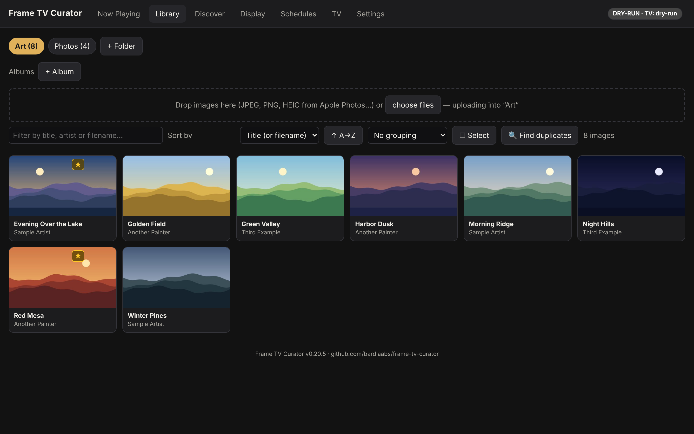
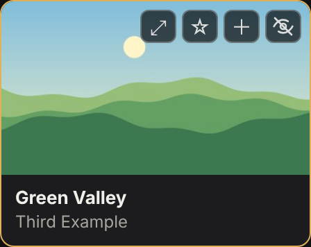
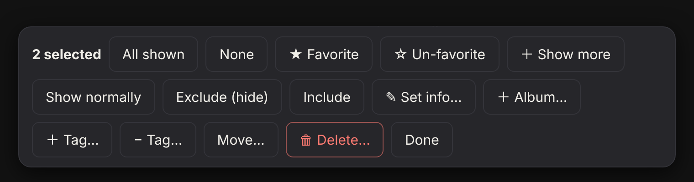
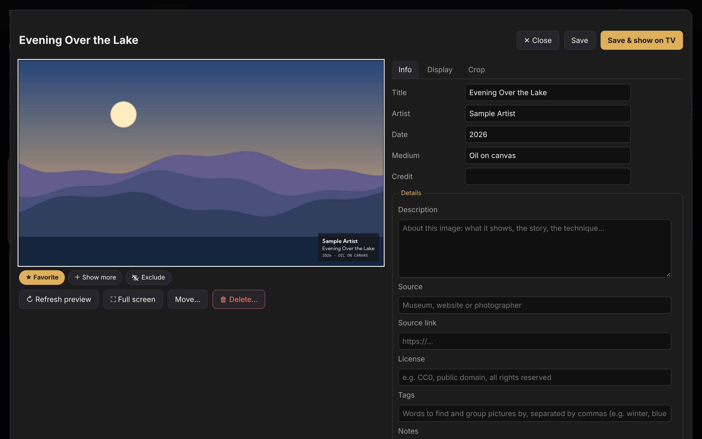
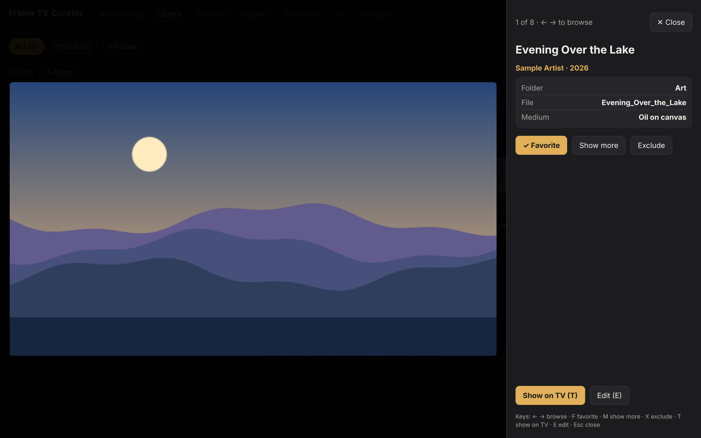
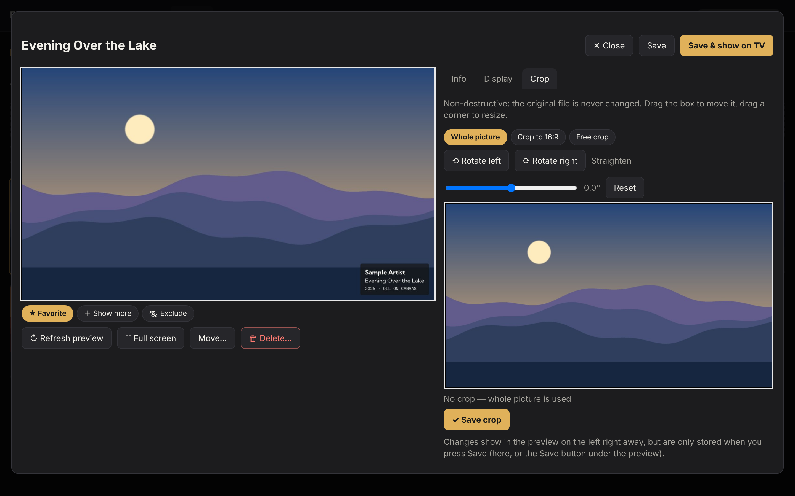

# Library

Browse, search and manage your images. Folders map to subfolders of `frame/` on the media share.

## Add pictures, step by step

- **By file share:** copy images into a folder under `frame/` on your media share (for example `frame/Art/`). New files appear within a minute.
- **By upload:** open the **Library** tab, choose the folder chip, then drag images onto the dashed box or click **choose files**.
- **From museums:** use [Discover](Discover).

## Create a folder
1. Click **+ Folder**, type a name and confirm. Or type a new name in the Move dialog or in Discover.
2. The folder appears as a chip at the top, in alphabetical order.

## Select many pictures

1. Click **Select** (it changes to *Selecting*).
2. Click the pictures you want, or use **All shown**.
3. Use the bar at the bottom: **Favorite / Un-favorite**, **Show more**, **Show normally**, **Exclude (hide)**, **Include**, **Set info...**, **Album...**, **+ Tag... / - Tag...**, **Move...** or **Delete...** (deleted pictures go to `_trash`).
4. Click **Done**.

**Move...** opens a dialog with a dropdown of your existing folders (with counts) or a box for a new folder name.

## Flags
- **Star** = favorite (shown more often).
- **Plus** = "show more".
- **Eye-slash** = exclude from rotation.

## Editing an image
Editing is non-destructive. Crop, rotate, straighten, titles and look settings are saved in the image's sidecar and applied only when the picture is rendered for the TV. The original file is never rewritten.

1. Click a picture's tile to open the editor.
2. The **Info** tab holds the text and details; **Display** holds the per-picture look; **Crop** holds crop, rotate and straighten.
3. Click **Save**, or **Save & show on TV** to render and send it right away.

The editor lets you crop, rotate, straighten, adjust its display look (mat, placard) and edit its **Info** (title, artist, date, medium, collection, description, notes, source link, license). All edits are stored in a sidecar file next to the image, so the original file never changes.

## Tools
- Bulk actions on a selection, quick flag buttons.
- EXIF and place-name prefill from photo metadata.
- Duplicate finder and low-resolution warnings.

## Sidecars
Each image may have a `name.json` sidecar (schema `frame-art-sidecar/1`) holding metadata, edits, flags and per-image display overrides. Copy or back up images together with their sidecars. **Editing is non-destructive:** crop, rotate, straighten and every look option are stored in the sidecar and applied only when the picture is rendered for the TV; the image file is never rewritten. The full file layout is on the [Sidecar files](Sidecar-Files) page.

## Grouping
Use **Group by** (next to Sort by) to show the grid under headings by year, decade, artist or medium. The chips above the grid jump to a group, and the heading stays at the top while you scroll its images. Sorting still applies inside each group; Undated/Unknown groups come last. The choice is remembered in your browser.

## Albums
An album is a named collection of images from any folder; an image can be in several albums, and albums never move or copy files.
- Create one with **+ Album** under the folder chips, then switch **Select** on, pick images (in any folder) and choose **+ Album...** in the bar at the bottom. In an album, **- Remove from album** takes the selected images out again.
- Use an album as the rotation source (Settings > Pick from > An album) or in a schedule (Schedules > Show > An album).
- Moving an image to another folder keeps it in its albums; deleting an image removes it from them. Deleting an album does not delete its images.

## Large preview (lightbox)

Hover a tile and click the expand button (⤢) to see the picture large. Use ← and → to browse in the order the grid shows (including groups). Keys: **F** favorite, **M** show more often, **X** exclude, **T** show on the TV, **E** open the editor, **Esc** close. The same buttons are in the side panel.

## Tags

Tags are your own words for finding pictures (for example `winter`, `blue`, `family`). Add them in the editor under Info > Details > Tags, separated by commas, or select several images and use **+ Tag…** or **− Tag…** in the selection bar. When any tags exist a **Tags** row of chips appears under the folders: click one to show only those pictures (click again to clear). The search box also matches tags. Tags are saved in each picture's sidecar, so they never touch the original file.

## Crop, rotate and straighten

1. Open the picture and choose the **Crop** tab.
2. Drag the crop box (16:9 or free) and use the rotate and straighten controls.
3. Click **Save crop**, then **Save**. Originals never change.

