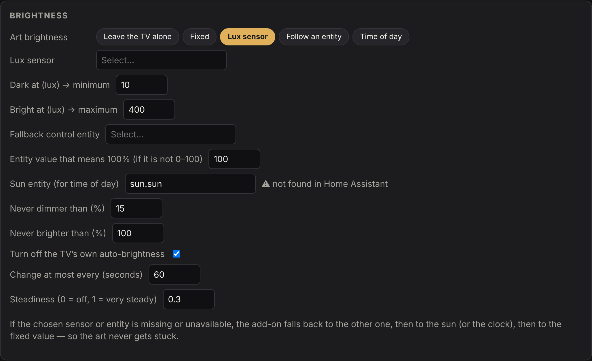
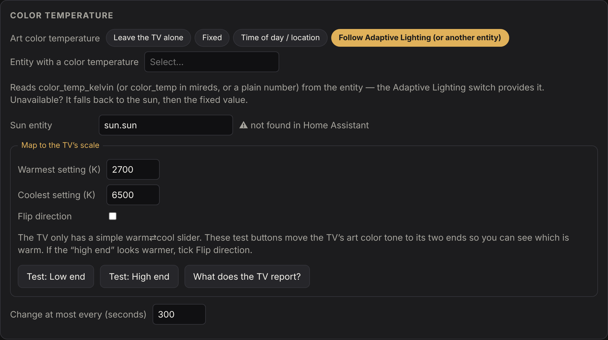
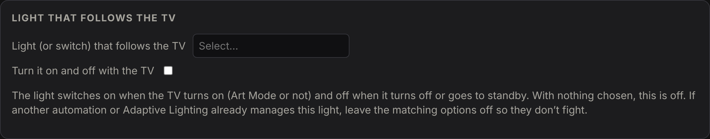

# Optional: ambient brightness, color temperature and companion light

All of this is off by default and lives on the **TV** tab. Every entity-linked feature lets you choose the entity yourself and falls back to something safe if the entity is missing, so rotation never breaks.

## Art brightness

Mode choices: **Leave the TV alone** (default), **Fixed**, **Lux sensor**, **Follow an entity**, **Time of day**.

### Fixed brightness, step by step
1. **TV** tab > **Brightness** card, choose **Fixed**.
2. Set **Brightness (%)** (default 60).
3. **Save & apply now**.

### Follow a room light sensor (lux), step by step
1. Choose **Lux sensor**.
2. Pick your illuminance sensor in **Lux sensor**.
3. Set **Dark at (lux) -> minimum** (default 10) and **Bright at (lux) -> maximum** (default 400).
4. Set **Never dimmer than** (15) and **Never brighter than** (100).
5. **Save & apply now**.

### Follow another entity
Choose **Follow an entity**, pick the **Control entity**, and set **Entity value that means 100%** if it is not on a 0-100 scale.

### Follow the time of day
Choose **Time of day**; it follows the **Sun entity** (default `sun.sun`).

### Other settings
- **Turn off the TV's own auto-brightness** (default on) stops the TV's sensor from fighting the add-on.
- **Change at most every (seconds)** (default 60) limits how often it changes.
- **Steadiness** (default 0.3): if the brightness keeps flipping between two neighboring steps, raise it. 0 is the old behavior, 1 is very steady.
- Fallback chain: the chosen sensor or entity, then the other one, then the sun or clock, then the fixed value.

The TV's brightness scale is 0-10; the add-on converts your percentages.

## Art color temperature

Mode choices: **Leave the TV alone** (default), **Fixed**, **Time of day / location**, **Follow Adaptive Lighting (or another entity)**.

### Follow Adaptive Lighting, step by step
1. **Color temperature** card, choose **Follow Adaptive Lighting (or another entity)**.
2. Pick the **Entity with a color temperature** (for example the Adaptive Lighting switch; it reads `color_temp_kelvin`).
3. Set **Warmest setting (K)** and **Coolest setting (K)** (default 2700 and 6500) to map onto the TV's warm-cool slider.
4. Click **Test: Low end** and **Test: High end**; if the "high" end looks warmer on the TV, tick **Flip direction**.
5. **Save & apply now**.

Other modes: **Fixed** (a Kelvin value, default 5000) and **Time of day / location** (**Night (K)** 2700 and **Daylight (K)** 6500 from the sun entity). The TV only has a simple warm-to-cool scale (-5 to +5), so values are mapped onto it.

## Companion light

1. **Light that follows the TV** card, pick a **Light (or switch)**.
2. Tick **Turn it on and off with the TV**.
3. Optional: sync its brightness and color temperature within a minimum and maximum percent.
4. **Save settings**.

With nothing chosen this is off. If another automation or Adaptive Lighting already manages the light, leave the matching options off so they do not fight.
