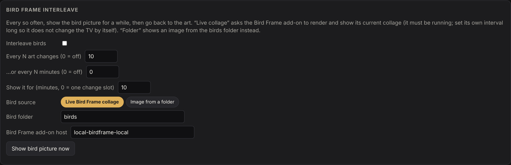

# Optional: Bird Frame and e-paper

Both are off by default and are set on the **Settings** tab.

## Bird Frame interleave

Mixes bird pictures into the rotation.

### Set it up, step by step
1. Install and start the Bird Frame add-on if you want the live collage (set its own interval long so it does not change the TV by itself).
2. In Frame TV Curator open **Settings > Bird Frame interleave** and tick **Interleave birds**.
3. Choose how often: **Every N art changes** (default 10) or **...or every N minutes**.
4. Set **Show it for (minutes)** (default 10; 0 = one change slot).
5. Choose **Bird source**: **Live Bird Frame collage** or **Image from a folder** (then pick the **Bird folder**).
6. Click **Save settings**. Use **Show bird picture now** to test.

## E-paper card

Sends a small card (current title, artist and more) to an e-paper display through Home Assistant.

1. Open **Settings > E-paper card** and tick **Send info to e-paper**.
2. Enter your display's **Device ID**.
3. Choose a **Style**: Gallery, Inverted or Grid.
4. Click **Save settings**.
