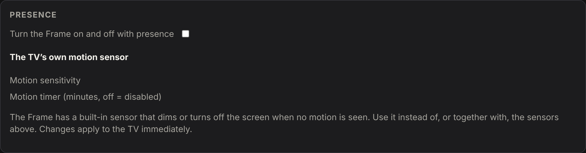

# Optional: presence

Turn the TV off when nobody is around, and bring it back to Art Mode when someone returns. Off by default.

## Set it up, step by step

1. Open the **TV** tab and find the **Presence** card.
2. Tick **Turn the Frame on and off with presence**.
3. Choose one or more presence entities (a binary sensor or person). Any one being "on" counts as someone being home.
4. Set **Away minutes**: how long nobody must be detected before the TV is turned off (default 10).
5. Choose the **Away action**: **Power off** (default) or leave Art Mode.
6. Keep **On return** ticked so the TV comes back when someone arrives, and **Only act in Art Mode** ticked so the add-on never turns off the TV while you are watching.
7. Optional: **Active hours** (for example `06:00-01:00`) so it only acts during the day, and **Fallback hours** (a clock window used only if every sensor is unavailable).
8. Click **Save & apply now**.

## How it behaves
- It wakes the TV on return after an absence it turned the TV off for, **or** when the TV is off and the sensors read "nobody" for at least **Also wake a TV that is off after being away at least** (default 2 minutes). So a TV switched off by something else while you were out still comes back. If you switch the TV off yourself while you stay in the room, or after only a short absence, it stays off.
- That "I turned it off" memory survives add-on updates and restarts.
- If every sensor is unavailable it does nothing, or uses the fallback hours if you set them.
- Use the **What it is doing now** card to see the current presence state.

## The TV's own motion sensor
The Frame has a built-in sensor that dims or turns off the screen when no motion is seen. In the same card you can choose the entities for **Motion sensitivity** and **Motion timer** (minutes, off = disabled) if your TV integration provides them. Changes apply to the TV immediately.
