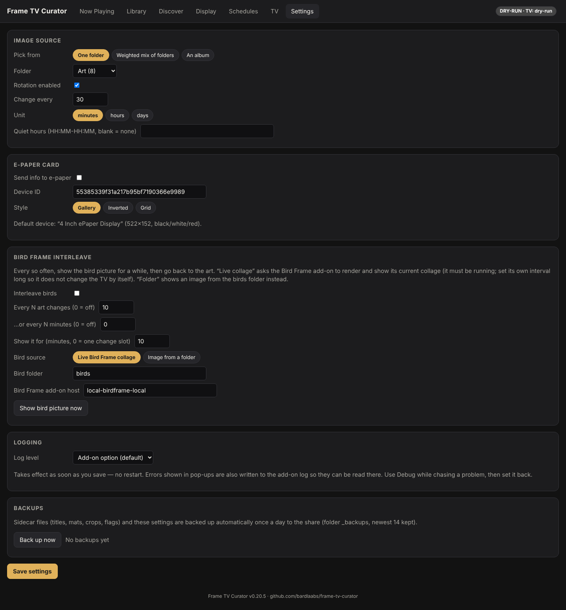
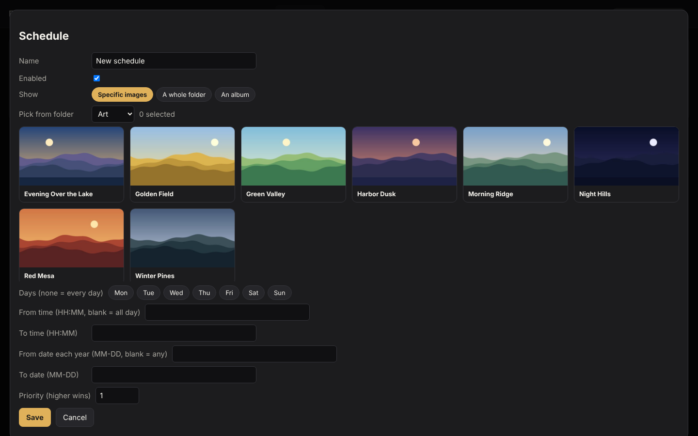
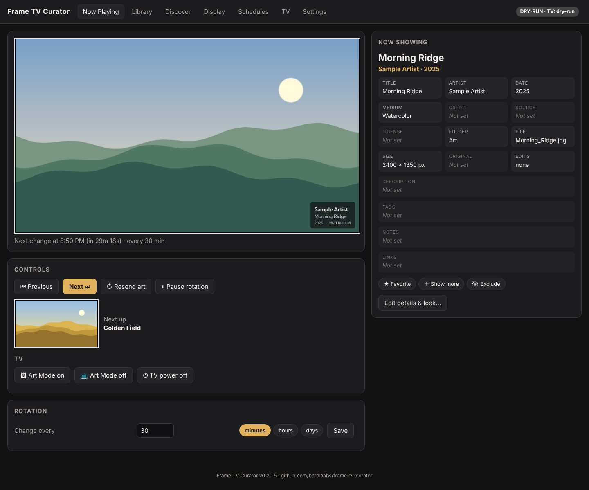

# Rotation and schedules

## Set up rotation, step by step
1. Open the **Settings** tab.
2. Under **Image source** choose **Pick from**:
   - **One folder**, then pick the **Folder**.
   - **Weighted mix of folders**, then give each folder a percentage (default Art 70 / Photos 30).
   - **An album**, then pick the album (create one first in the Library).
3. Make sure **Rotation enabled** is ticked.
4. Set **Change every** and the **Unit** (minutes, hours or days). 30 minutes is the default; choose **days** for a slow change.
5. Optional: fill in **Quiet hours** such as `23:00-07:00` so the picture holds still overnight.
6. Click **Save settings** at the bottom.

## How a picture is chosen
Rotation uses a **shuffle bag**: every picture is shown once before any repeats. **Favorites** and **Show more** pictures are in the bag more than once so they come up more often; **Excluded** pictures never appear. Set these flags with the buttons on each tile in the Library.

## Schedules (special occasions and time windows)

A schedule replaces the normal source while it is active. Use it for holidays, evenings, or weekday patterns.

### Add a schedule, step by step
1. Open the **Schedules** tab and click **+ Add schedule**.
2. Give it a **Name** and keep **Enabled** ticked.
3. Under **Show** choose **Specific images**, **A whole folder** or **An album**, then pick them.
4. Set when it applies. Fill in any of these (all that you fill in must match):
   - **Days** of the week (none = every day).
   - **From time / To time** (HH:MM). A window that ends before it starts runs past midnight.
   - **From date / To date each year** (MM-DD), for example `12-24` to `12-25`. One date means that single day. A range may wrap over New Year.
5. Set **Priority** if schedules can overlap: the higher number wins.
6. Click **Save**, then **Save settings**.

The art changes as soon as a schedule starts or ends.

## Behavior notes
- A TV change takes about 10-14 seconds.
- The add-on only pushes while the TV is in Art Mode.
- Use the Now Playing buttons (**Previous**, **Next**, **Resend**, **Pause rotation**) to override rotation by hand.

