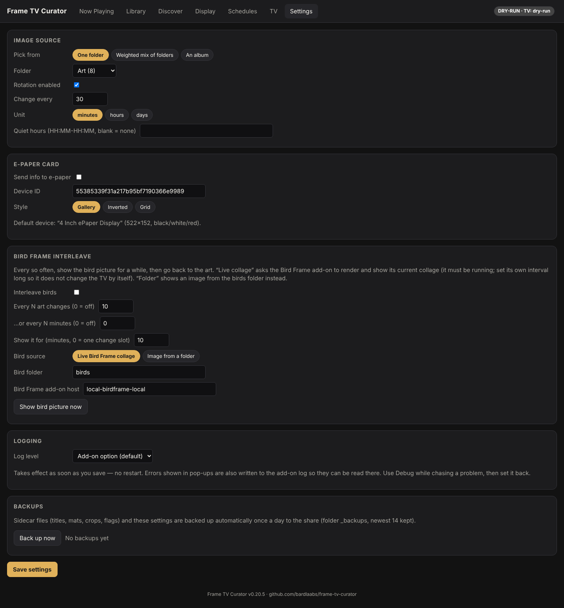
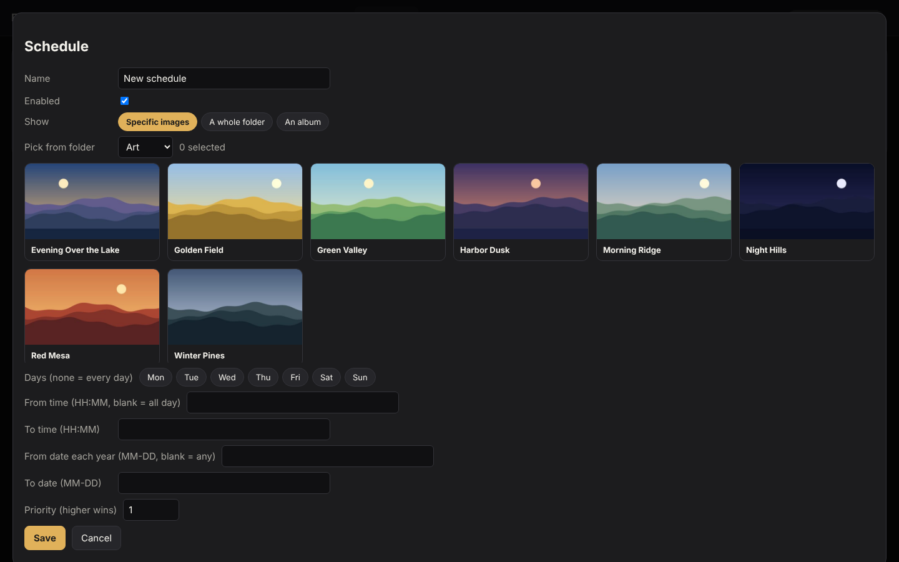
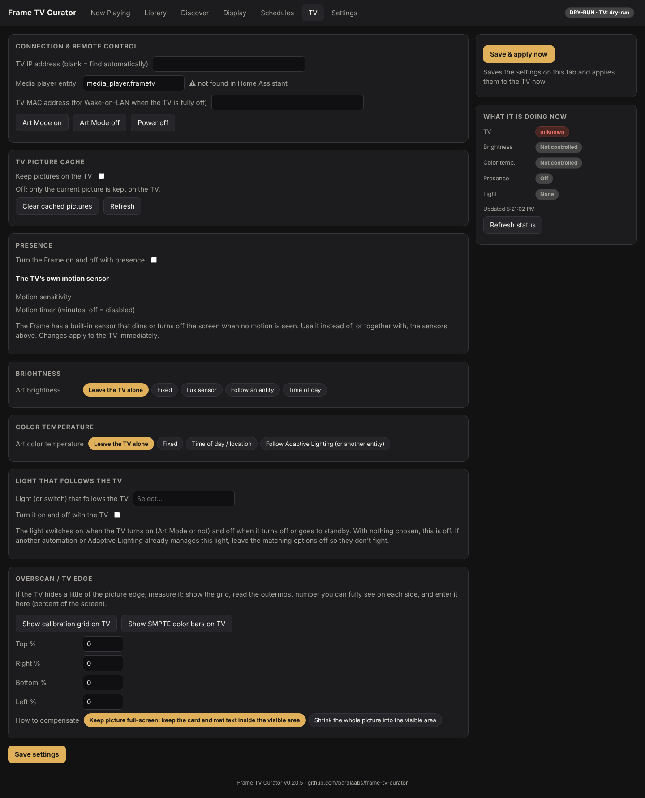

# Settings reference

Every setting in Frame TV Curator: where to find it, its default, typical values and what it does. Settings are saved in the add-on's private data folder; **Save settings** on a tab applies that tab. For pictures of the Display options see [Display and look](Display-and-Look).

Sections:
[Add-on options](#add-on-options) · [Settings tab](#settings-tab) · [Display tab](#display-tab) · [Schedules tab](#schedules-tab) · [TV tab](#tv-tab) · [Discover](#discover) · [Per-image settings](#per-image-settings)

## Add-on options

Set these in Home Assistant under **Settings > Add-ons > Frame TV Curator > Configuration**, then restart the add-on.

| Option | Default | Typical | What it does |
|---|---|---|---|
| `log_level` | `info` | `info`, or `debug` while troubleshooting | How much the add-on writes to its log. The Settings tab can override it. |
| `tv_ip` | blank | `192.168.1.50` | The TV's address. Blank means find it from the media player entity. |
| `dry_run` | off | off | When on, pictures are rendered but never sent to the TV. Use for testing. |
| `smithsonian_key` | blank | your free api.data.gov key | Needed only for the Smithsonian source in Discover. Restart after saving. |

## Settings tab

### Image source

| Setting | Default | Typical | Description |
|---|---|---|---|
| Pick from | One folder | One folder, Weighted mix, An album | Where rotation draws pictures from. |
| Folder | `Art` | any folder | The folder used when Pick from is One folder. |
| Mix (weighted mix) | Art 70 %, Photos 30 % | any split | Relative weights per folder when Pick from is Weighted mix. |
| Album | none | any album | The album used when Pick from is An album. |
| Rotation enabled | On | On | Turns automatic picture changes on or off. The Now Playing buttons still work when off. |
| Change every | 30 | 15-60 minutes, or 1-24 hours | How long each picture stays up. |
| Unit | minutes | minutes, hours, days | The unit for **Change every**. |
| Quiet hours | blank | `23:00-07:00` | A window (HH:MM-HH:MM) when the picture does not change. Blank means none. |

How the picker works: every picture is shown once before any repeats (a "shuffle bag"). **Favorite** and **Show more** pictures are in the bag more than once; **Excluded** pictures are never in it.

### E-paper card

| Setting | Default | Typical | Description |
|---|---|---|---|
| Send info to e-paper | Off | Off unless you have the display | Sends the current title and artist to an e-paper display through Home Assistant. |
| Device ID | the author's display | your device's ID | The Home Assistant device to send to. |
| Style | Gallery | Gallery, Inverted, Grid | How the card looks. |

### Bird Frame interleave

| Setting | Default | Typical | Description |
|---|---|---|---|
| Interleave birds | Off | Off | Turns bird pictures in the rotation on or off. |
| Every N art changes | 10 | 5-20 (0 = off) | Show the bird picture after this many art changes. |
| ...or every N minutes | 0 | 30-120 (0 = off) | Show it on a clock instead. |
| Show it for (minutes) | 10 | 5-15 (0 = one change slot) | How long the bird picture stays up. |
| Bird source | Live Bird Frame collage | Live collage, Image from a folder | Where the bird picture comes from. |
| Bird folder | `birds` | any folder | Used when the source is a folder. |
| Bird Frame add-on host | `local-birdframe-local` | leave as is | Where the Bird Frame add-on lives (port 8099). |

### Logging and backups

| Setting | Default | Typical | Description |
|---|---|---|---|
| Log level | Add-on option | Info | Overrides the add-on option instantly with no restart. Choices: Debug, Info, Warnings only, Errors only. |
| Back up now | n/a | n/a | Copies sidecars and settings to the share's `_backups` folder. Daily automatic backups keep the newest 14. |

## Display tab

See [Display defaults](Display-Defaults) for the full table with pictures. In short:

| Setting | Default | Typical | Description |
|---|---|---|---|
| Show placard | On | On | Prints artist, title, date and medium on a card. |
| Template | Modern Minimal | Modern Minimal, Classical Editorial, Gallery Zine | Placard style. |
| Placement | Box over image | Box over image, Printed on the mat | Over the picture or on the mat strip. |
| Position | Bottom right | any of six | Where an over-image card sits. |
| Size (scale) | 1 | 0.8-1.6 | Text size multiplier. |
| Card margin from edge (%) | 2.2 | 1.5-4 | Gap between card and screen edge. |
| Auto-fit text to the mat height | Off | Off, or On for mat placards | Largest text that fits the mat strip. Ignores Size. |
| Layout when printed on the mat | Two lines | Single, Two or Three lines | Line arrangement on the mat. |
| Divider line (modern) | Off | Off | A thin line in the Modern template. |
| Use a mat | Off | Off, or On for art | Border around the picture. |
| Mat color from the picture | blank (fixed) | Warm gallery white, Deep neutral, Best contrast... | Picks the mat color from the artwork. |
| Fixed mat color | `#efece4` | any color | Used when no picture-based color is chosen. |
| Width (% of height) | 6 | 4-12 | Mat thickness. |
| Mat shape | Even | Even, Proportional | Trim the picture slightly (even) or keep it whole (proportional). |
| Texture | Flat | Flat, Paper, Linen | Grain on the mat. |
| Non-16:9 images | Mat fills the sides | Mat fills the sides, Black bars inside, Even mat black outside | Handling of pictures that are not 16:9. |
| Use an inner liner | Off | Off, or On for a framed look | Thin second mat around the picture. |
| Liner color | `#2b2b2b` | any color | Liner color. |
| Liner width (% of height) | 0.8 | 0.5-1.5 | Liner thickness. |
| Bevel | On | On | Angled cut edge of the mat opening. |
| Bevel Width | 0.4 | 0.3-0.9 | Bevel thickness (% of height). |
| Bevel Intensity | 60 | 40-90 | Strength of the bevel shading. |
| Light direction | 0 | 0-360 | Degrees clockwise from the top. |
| Light elevation | 50 | 30-70 | How high the light is. |
| Cast shadow | 35 | 0-60 | Shadow the picture casts on the mat. |
| Convert photos to sRGB | On | On | Converts tagged wide-gamut photos so colors look right. |

## Schedules tab

A schedule replaces the normal source while it is active. Click **+ Add schedule**.

| Setting | Default | Typical | Description |
|---|---|---|---|
| Name | New schedule | "Christmas" | A label for you. |
| Enabled | On | On | Turn a schedule off without deleting it. |
| Show | Specific images | Specific images, A whole folder, An album | What to show while active. |
| Pick from folder / Album | n/a | any | The pictures, folder or album. |
| Days | none (every day) | Mon-Fri | Days of the week it applies. |
| From time / To time | blank (all day) | `18:00` / `23:00` | Daily time window (HH:MM). A window that ends before it starts runs overnight. |
| From date / To date each year | blank | `12-24` / `12-25` | Date range each year (MM-DD). One date means that single day; a range that wraps over New Year works. |
| Priority | 0 | 0-10 | When two schedules overlap, the higher number wins. |

All the conditions you fill in must match for a schedule to be active.

## TV tab

### Connection and remote control

| Setting | Default | Typical | Description |
|---|---|---|---|
| TV IP address | blank | `192.168.1.50` | Blank means find it automatically from the media player entity. Same as the `tv_ip` add-on option. |
| Media player entity | `media_player.frametv` | your TV's entity | The Home Assistant entity for the TV. |
| TV MAC address | blank | `d0:c2:4e:xx:xx:xx` | Lets the add-on wake a fully off TV with Wake-on-LAN. |
| Name (pairing) | `FrameTVCurator` | leave as is | How the add-on appears in the TV's pairing list. |
| Keep uploads | 1 | 1 | Old uploaded pictures to keep on the TV when the cache is off. |
| Art Mode on / off, Power off | n/a | n/a | Remote-control buttons. |

### TV picture cache

| Setting | Default | Typical | Description |
|---|---|---|---|
| Keep pictures on the TV | Off | Off, or On if your TV is slow to upload | Reuses recent pictures instead of uploading again. |
| Keep the last N pictures | 5 | 3-10 | Number of recent pictures kept, including the current one. |
| Keep favorites | On | On | Also keep your favorites. |
| Max favorites | 10 | 5-20 | Cap on kept favorites. |
| Clear cached pictures | n/a | n/a | Removes them from the TV. |

### Presence

| Setting | Default | Typical | Description |
|---|---|---|---|
| Turn the Frame on and off with presence | Off | Off until you pick sensors | Master switch. |
| Presence entities | none | one or more binary sensors | Any one "on" means someone is home. |
| Away minutes | 10 | 10-30 | How long nobody must be detected before acting. |
| Away action | Power off | Power off, Leave Art Mode | What to do when everyone is gone. |
| On return | On | On | Wake the TV into Art Mode when someone comes back (only if the add-on turned it off). |
| Only act in Art Mode | On | On | Never turn the TV off while you are watching TV. |
| Active hours | blank | `06:00-01:00` | Only act within this window. Blank means always. |
| Fallback hours | blank | `07:00-22:00` | A clock window used only if every sensor is unavailable. |
| Motion sensitivity / timer entities | the author's entities | your TV's select entities | Controls for the Frame's built-in motion sensor, set from the same card. |

### Art brightness

| Setting | Default | Typical | Description |
|---|---|---|---|
| Art brightness (mode) | Leave the TV alone | Fixed, Lux sensor, Time of day | How brightness is chosen. |
| Brightness (%) | 60 | 30-80 | The level for Fixed (also the last-resort fallback). |
| Lux sensor | none | an illuminance sensor | The room light sensor for Lux mode. |
| Dark at (lux) -> minimum | 10 | 5-30 | At or below this the TV is at its minimum. |
| Bright at (lux) -> maximum | 400 | 200-1000 | At or above this the TV is at its maximum. |
| Control entity | none | any numeric entity | The value to follow in Follow an entity mode. |
| Entity value that means 100% | 100 | the entity's maximum | Use when the entity is not on a 0-100 scale. |
| Sun entity | `sun.sun` | `sun.sun` | Used for Time of day and as a fallback. |
| Never dimmer than (%) | 15 | 10-25 | Lower limit. |
| Never brighter than (%) | 100 | 80-100 | Upper limit. |
| Turn off the TV's own auto-brightness | On | On | Stops the TV's sensor from fighting the add-on. |
| Change at most every (seconds) | 60 | 60-300 | Minimum time between brightness changes. |
| Steadiness | 0.3 | 0.3-0.7 | 0 = old behavior, 1 = very steady. Raise it if brightness flips between two steps. |

If a chosen sensor or entity is missing, the add-on falls back to the other one, then the sun or clock, then the fixed value.

### Color temperature

| Setting | Default | Typical | Description |
|---|---|---|---|
| Art color temperature (mode) | Leave the TV alone | Fixed, Time of day, Follow Adaptive Lighting | How warmth is chosen. |
| Color temperature (K) | 5000 | 2700-6500 | The value for Fixed. Lower is warmer. |
| Night (K) / Daylight (K) | 2700 / 6500 | same | Values for Time of day mode. |
| Entity with a color temperature | none | an Adaptive Lighting switch | The entity to follow; its `color_temp_kelvin` is read. |
| Warmest / Coolest setting (K) | 2700 / 6500 | same | How Kelvin maps to the TV's warm-cool slider. |
| Flip direction | Off | Off | Turn on if the TV's slider runs the other way (use the Test buttons). |
| Change at most every (seconds) | 300 | 300 | Minimum time between changes. |

### Light that follows the TV

| Setting | Default | Typical | Description |
|---|---|---|---|
| Light (or switch) that follows the TV | none | a lamp near the TV | The companion light. |
| Turn it on and off with the TV | Off | On | Light on when the TV turns on, off when it turns off. |
| Match brightness / color temperature | Off | optional | Copies the TV's art settings to the light. |
| Light min / max (%) | 10 / 100 | 10-100 | Limits when matching brightness. |

### Overscan / TV edge

| Setting | Default | Typical | Description |
|---|---|---|---|
| Top / Right / Bottom / Left % | 0 | 0-3 | How much of each edge your TV hides. |
| How to compensate | Keep picture full-screen | Keep full-screen, or Shrink | Move the card inside the visible area, or shrink the whole picture. |

## Discover

Discover remembers its last source, type, search, artist, order, page, folder and album in your browser. Each source has its own options; see [Discover](Discover).

## Per-image settings

Stored in each picture's sidecar and edited in the image editor.

| Setting | Where | Description |
|---|---|---|
| Title, Artist, Date, Medium, Credit | Info | The text on the placard and in Now Playing. Photos use Location instead of Medium and Credit. |
| Description, Source, Source link, License, Tags, Notes | Info > Details | Extra facts; Notes are private. |
| GPS location | Info (photos) | Coordinates and place name. |
| Favorite, Show more, Exclude | under the preview | How often the picture appears. |
| Crop, Rotate, Straighten | Crop | Non-destructive edits. |
| Placard, Mat, Inner liner, Bevel and lighting overrides | Display > Customize | Per-picture look. |
