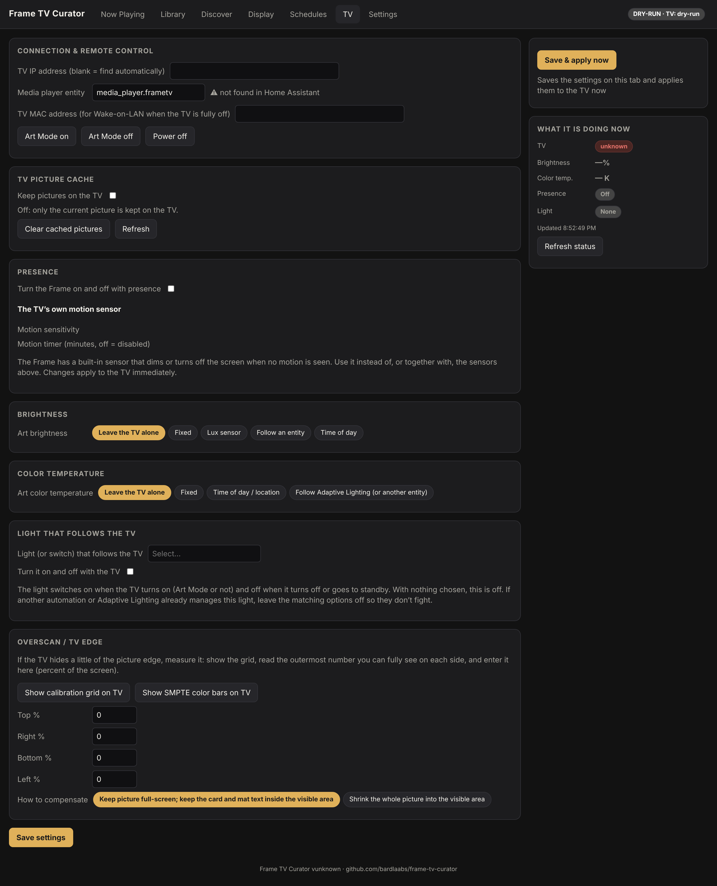
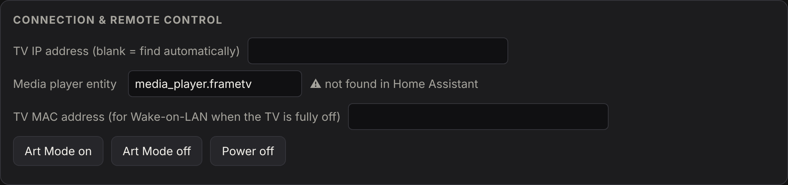
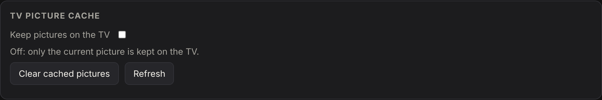
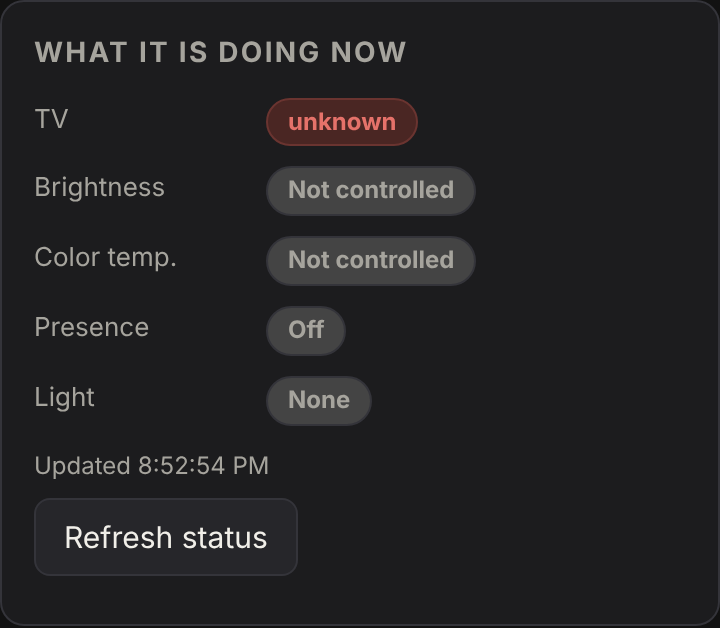

# TV tab

## Connect to the TV, step by step

1. Open the **TV** tab, **Connection & remote control** card.
2. Leave **TV IP address** blank to find the TV from the media player entity, or enter it (same as the `tv_ip` add-on option).
3. Choose the **Media player entity** (default `media_player.frametv`). A warning appears if it is not found in Home Assistant.
4. Enter the **TV MAC address** if you want the add-on to wake a fully powered-off TV with Wake-on-LAN.
5. Click **Save settings**.
6. Try the buttons: **Art Mode on**, **Art Mode off**, **Power off**. The first time the add-on connects, accept the pairing prompt on the TV.

If the TV is fully off, "Art Mode on" first tries Home Assistant's turn-on, then Wake-on-LAN (needs the MAC), waits for the TV and sets Art Mode. This runs in the background and takes about a minute.

## TV picture cache (optional)

Off by default. When on, the add-on keeps the last N pictures (default 5, including the current one) and optionally your favorites (default up to 10) on the TV instead of deleting each picture when the next one arrives.

### Turn it on
1. In the **TV picture cache** card tick **Keep pictures on the TV**.
2. Set how many recent pictures and favorites to keep.
3. Click **Save settings**.

- Showing a kept picture again only selects it on the TV (a couple of seconds, no upload).
- Kept pictures stay on the TV in Art Store > My Photos, so they remain available when Home Assistant is down.
- If you change a picture's look or edits, a fresh copy is uploaded and the old one is removed.
- **Clear cached pictures** removes them all from the TV.

## Overscan / TV edge
See [Display and look](Display-and-Look#overscan) for the step-by-step calibration.

## Presence, brightness, color and companion light

These cards are on the same tab. Each is described on its own page:
- [Presence](Optional-Presence)
- [Ambient brightness, color temperature and companion light](Optional-Ambient)

Click **Save & apply now** (in the right-hand column) to save the TV tab and apply it to the TV immediately. The **What it is doing now** card shows the live result.
